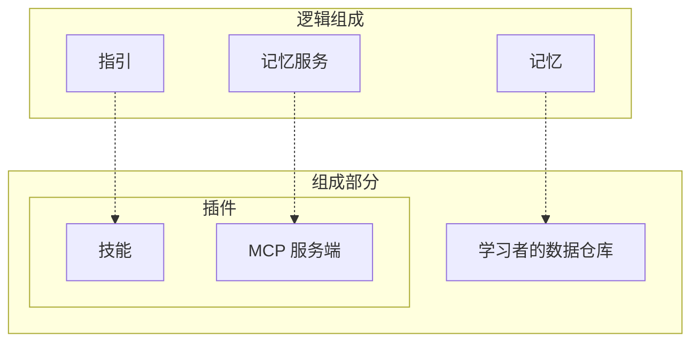

# Cairn 文档总览

本文是 Cairn 基础版设计的入口，说明产品定位、共同学习模型、系统组成和文档之间的关系。

## Cairn 是什么

Cairn 是面向个人的 AI 辅助学习系统。它支持学习者形成和调整学习目标，使模型能够结合已有知识、当前表现、任务要求和使用条件选择辅导方式。学习中的观察、约定与判断通过长期记忆延续，后续对话可以据此继续学习。

系统把学习者的记忆以纯文本保存在其自己的 git 仓库中，并提供辅导指引和读写记忆的工具。学习者更换客户端或模型后，目标、进度和相关依据仍然可以被理解和使用。辅导的成效体现为学习者在目标任务上的能力变化，以及为此投入的时间、负担和持续参与情况。

## 两个版本

本仓库同时保存现行实现与基础版设计。

| 版本 | 形态 | 状态 | 文档 |
|---|---|---|---|
| 现行版本（v1） | 远程 MCP 服务，协作说明随工具返回 | 已实现 | 根目录的 [README.md](../README.md) 和 [DESIGN.md](../DESIGN.md)、[server/SPEC.md](../server/SPEC.md)、`harness/`、[DEPLOY.md](DEPLOY.md) |
| 基础版 | 客户端插件，由技能、MCP 服务端和数据仓库组成 | 共同模型与设计方向已确认，设计正文和规格逐项细化，尚未实现 | 本文及以下列出的设计、组成部分和决策文档 |

基础版保留进行学习与跨对话延续状态所需的基本组成，其他功能依据实际需要作为扩展模块加入。本文以下各节均针对基础版；各项结论的效力与详细进度见[议题与决策](decisions.md)。

## 设计纲要与阅读顺序

设计按“目标与哲学—共同学习模型—辅导判断—长期记忆—组成部分”的顺序展开。这一顺序说明文档之间的依赖关系；模型在实际学习中依据情境组织活动。

### 目标与设计哲学：系统服务什么结果

[目标、边界与设计哲学](design/goals-and-principles.md)说明 Cairn 的产品目标、范围与设计取舍。它阐明学习者的决定权、记忆的可迁移性、模型自主判断与可复用指导的关系，以及系统如何依据使用经验演进。

本章同时定义产品成功的判断方向：学习者是否更接近目标能力，能力能否在目标使用条件下发挥作用，辅导所需的时间与负担是否合适。后续教学安排、记忆内容和扩展功能据此判断其价值。

### 共同学习模型：用哪些概念理解学习

[共同学习模型](design/learning-model.md)定义学习目标、目标能力、使用条件、学习状态、任务、学习活动、支持、表现和证据，并说明它们如何共同支持教学判断。

目标可以从学习者的愿望、问题、材料或任务出发，在模型协助下逐渐细化；学习状态用于理解当前基础与困难；活动和支持为能力发展提供条件；表现结合任务与支持条件成为判断依据。模型据此调整辅导，学习者根据新的认识决定目标与投入的变化。这些关系适用于阅读、解释、实现、调试、写作和探究等活动。

### 辅导判断：如何选择和调整教学安排

[辅导](design/tutoring.md)将共同模型展开为教学判断：如何理解当前任务与学习目标的关系，识别困难，选择活动与支持，提供反馈，以及根据表现调整安排。

学习方法在此被组织为具有明确适用条件的可复用辅导知识。它可以说明原理、权衡因素、具体做法和可观察的调整依据。模型结合当前情境选择和组合方法；个人偏好、投入约定和任务限制共同影响选择。文献依据、设计推论和具体例子在相应主题中展开。

### 长期记忆：哪些信息应当延续，如何解释

[记忆](design/memory.md)说明后续辅导需要保留哪些信息，以及学习者的选择、自述、观察和模型判断各具有什么效力。目标与约定用于确定安排，观察及其条件用于支持判断，学习状态随新的依据更新。

本章进一步说明跨对话延续、信息来源、不确定性和修订的关系。学习者设定、学习状态和学习记录分别承载这些内容，个人约定的适用范围与具体存储映射继续细化；页面、链接和时间信息提供可阅读、可核对的组织方式。

### 组成部分：各部分怎样共同承担上述职责

组成部分文档承接设计层，分别说明[技能](components/skill.md)、[记忆服务](components/server.md)、[数据仓库](components/data-repo.md)与[插件](components/plugin.md)的职责和约定。技能向模型提供辅导指引与参考内容，记忆服务承担读写和确定性工作，数据仓库保存学习者的记忆，插件组织分发与客户端连接。

工具规格、具体文件组织和模型指引正文在相关设计明确后细化。设计层定义信息的含义与使用依据，组成部分定义它们如何被提供、保存和更新。

## 总体结构

系统由三个逻辑组成构成：**指引**说明如何辅导与使用记忆；**记忆**保存后续辅导所需的学习者信息；**记忆服务**提供模型读写记忆的统一途径，并承担确定性的工作。实现上，指引对应技能，记忆服务对应 MCP 服务端，记忆对应学习者的数据仓库。

| 逻辑组成 | 职责 | 实现 | 文档 |
|---|---|---|---|
| 指引 | 说明角色、目标、教学判断和记忆使用方式；提供条件明确的学习方法 | 技能正文与参考文件 | [辅导](design/tutoring.md)、[技能](components/skill.md) |
| 记忆服务 | 提供读取、写入与计算，保证写入规则，负责同步 | MCP 服务端及其工具 | [服务端](components/server.md) |
| 记忆 | 延续学习者的约定、相关信息、观察及学习状态 | 学习者的数据仓库（git） | [记忆](design/memory.md)、[数据仓库](components/data-repo.md) |

学习材料包括课程、书籍、代码等对象，按数据仓库的约定提供给模型阅读。技能和 MCP 服务端的连接声明打包为插件，随系统仓库发布。

三个逻辑组成通过三项约定衔接：

- **工具接口**连接指引与记忆服务，说明何时读写以及各工具提供什么。
- **记忆格式**连接记忆服务与记忆，规定目录、页面、记录和链接的表示方式。
- **信息语义与效力**连接指引与记忆，说明一项内容是学习者的约定、事实性自述、观察还是推断，以及模型据此可以作出什么判断。

这些约定支持各组成部分独立演进，同时维持辅导与记忆之间的连续性。

## 文档的层次

| 层次 | 回答的问题 | 文档 | 内容 |
|---|---|---|---|
| 总览 | 系统是什么，各部分与各章怎样关联 | 本文 | 产品定位、设计纲要、总体结构、术语和当前状态 |
| 设计 | 系统服务什么结果，设计取舍依据什么 | [目标、边界与设计哲学](design/goals-and-principles.md) | 产品目标、成功标准、范围与设计立场 |
| 设计 | 学习中的核心概念及其关系是什么 | [共同学习模型](design/learning-model.md) | 目标形成、目标能力与使用条件、学习状态、活动与支持、表现与证据 |
| 设计 | 模型怎样作出和调整教学判断 | [辅导](design/tutoring.md) | 活动选择、支持、反馈、判断修订、条件性方法与理论依据 |
| 设计 | 学习信息怎样在后续辅导中延续 | [记忆](design/memory.md) | 信息语义、来源与效力，记忆组织、更新和跨对话使用 |
| 组成部分 | 技能提供什么，如何组织供模型使用的内容 | [技能](components/skill.md) | 指引与参考内容的职责、加载与后续编写依据 |
| 组成部分 | 记忆服务承担什么职责 | [服务端](components/server.md) | 工具列表、读写约定和服务端保证的规则 |
| 组成部分 | 记忆怎样以文件表示 | [数据仓库](components/data-repo.md) | 目录、名称、页面、记录、链接与格式版本 |
| 组成部分 | 系统怎样提供给不同客户端 | [插件](components/plugin.md) | 插件结构、运行方式、客户端支持与版本关系 |
| 实现 | 交给模型的正文、代码和模板是什么 | `skills/`、`server/`、`templates/data/` | 在基础版实现时建立或改写 |
| 过程 | 哪些方向已确认，哪些内容尚待细化 | [议题与决策](decisions.md) | 当前有效结论、历史决策、待细化问题与暂缓事项 |

共同概念集中在学习模型中定义；产品、辅导和记忆各章分别展开相应问题。组成部分引用设计含义，补充接口与格式。交给模型的完整正文、代码和模板属于实现层。

`archive/` 保存已被取代的[2026 年 10 月重构讨论](archive/refactor-2026-10.md)和[交接说明](archive/cairn-handoff-2026-10.md)。原教学分类及相关结论的变更记录保存在[历史决策](decisions.md#历史决策)。

## 术语

核心学习概念的完整定义与关系见[共同学习模型](design/learning-model.md)。

| 术语 | 含义 |
|---|---|
| 学习者 | 使用系统学习的人，也是个人数据仓库的所有者 |
| 模型 | 在客户端中提供辅导的 AI 模型 |
| 学习目标 | 学习者希望通过学习达到的结果，可以在学习过程中逐渐细化与调整 |
| 目标能力 | 为达到目标，需要形成或改善的理解、判断与行动能力 |
| 使用条件 | 目标能力预期发挥作用的情境、资源、支持与约束 |
| 学习状态 | 对学习进度、已有能力和相关特征的当前描述；其中的判断保留依据及适用条件 |
| 任务 | 在具体情境下需要解决的问题或完成的要求 |
| 学习活动 | 学习者围绕目标和任务进行的阅读、解释、分析、尝试、实施、反思等活动 |
| 支持 | 为推进学习活动提供的讲解、示范、提示、工具、反馈等帮助 |
| 支持条件 | 某次活动实际提供或使用的帮助及其范围 |
| 表现 | 学习者在具体条件下作出的回应、选择、行动及结果 |
| 证据 | 对相关能力判断具有支持或反驳意义的表现及其条件 |
| 学习项目 | 围绕相互关联的目标、材料和任务组织的一段持续学习 |
| 学习材料 | 学习中使用的课程、书籍、代码、论文等内容或对象 |
| 学习方法 | 适用条件明确、可复用的辅导知识，可以包括原理、权衡因素、具体做法和调整依据 |
| 教学原则 | 依据学习理论与设计目标形成、用于指导教学判断的基本要求 |
| 指引 | 告知模型如何辅导及如何使用记忆的正文，由技能提供 |
| 记忆 | 为后续辅导保留的学习者相关信息，包括约定、自述、观察和学习状态 |
| 学习者设定 | 学习者提供的个人情况、目标和辅导约定；具体内容的效力依其语义区分 |
| 学习记录 | 对学习过程中的事件、观察和来源的记录，按现有归档约定追加保存 |
| 页面 | 记忆的存取单位，即一个 Markdown 文件 |
| 链接 | 页面之间以 `[[页面名]]` 表示的引用 |
| 索引 | 服务端生成的页面清单，包含名称、摘要和时间信息 |
| 时间信息 | 服务端为页面计算的首次记录、最近涉及、涉及天数和最近更新 |
| 阶段性更新 | 在学习的阶段性停顿处，依据新信息更新相关记忆的工作 |
| 对话 | 学习者与模型在客户端中的交流；系统的更新约定不依赖对话的开始和结束 |
| 对话标记 | 学习记录上的可选标注，为关联同一次对话中的记录提供线索 |
| 客户端 | 运行模型并加载插件的应用 |
| 记忆服务 | 模型读写记忆的统一途径，由 MCP 服务端实现 |
| 技能 | 客户端加载的说明文件及其参考文件，是指引的实现形式 |
| 插件 | 技能、MCP 连接声明和可选增强功能的分发形式 |
| 系统仓库 | 本仓库，保存系统文档、插件、服务端源码与数据仓库模板 |
| 数据仓库 | 学习者自己的 git 仓库，保存其记忆 |
| 扩展模块 | 依据实际需要加入基础版的功能 |

## 当前状态

共同学习模型、产品设计方向和文档纲要已于 2026-11-19 确认。设计文档按上述结构展开，详细阐述概念、理由、关系、理论依据及例子。

当前需要细化的内容包括学习状态的更具体表述、个人约定的适用范围与存储映射、方法参考内容的具体组织，以及工具规格。指引正文依据相应设计继续完善。基础版尚未实现，各项有效结论及后续步骤见[议题与决策](decisions.md)。

