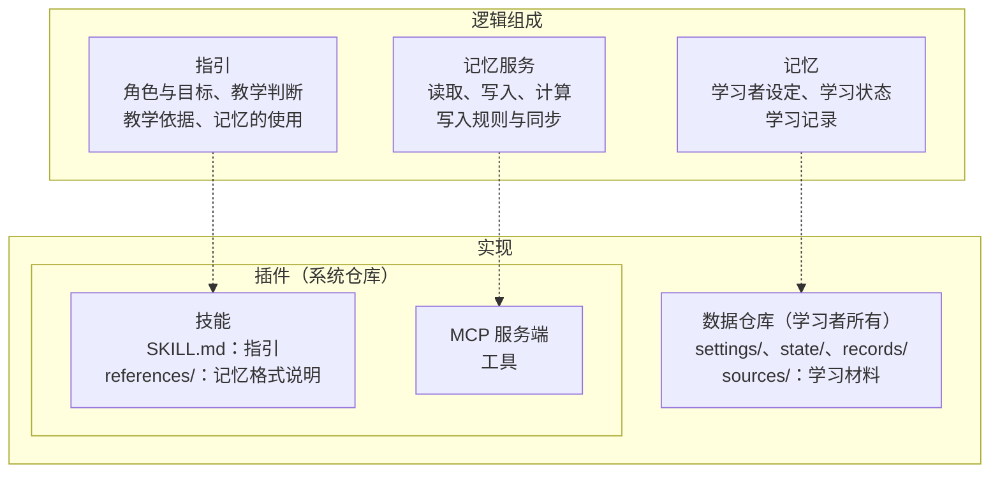

# Cairn 文档总览

本文件是 Cairn 文档的入口，说明系统的组成、文档的层次、术语和当前状态。

## Cairn 是什么

Cairn 是面向个人的 AI 辅助学习系统。它把与学习有关的记忆，以纯文本保存在学习者自己的 git 仓库中，包括：
- 学习者的目标与约定；
- 对学习者能力的判断及其依据；
- 学习记录。

在此基础上，Cairn 向模型提供辅导的指引和读写记忆的工具。模型据此围绕学习者的目标辅导：了解学习者当前能做到什么，安排有价值的学习活动，并依据表现修订判断。学习者更换客户端或模型后，学习可以从原有的状态继续。

## 两个版本

本仓库同时包含两个版本的内容。

| 版本 | 形态 | 状态 | 文档 |
|---|---|---|---|
| 现行版本（v1） | 远程 MCP 服务，协作说明随工具返回 | 已实现 | 根目录的 [README.md](../README.md) 和 [DESIGN.md](../DESIGN.md)、[server/SPEC.md](../server/SPEC.md)、`harness/`、[DEPLOY.md](DEPLOY.md) |
| 基础版 | 客户端插件，由技能、MCP 服务端和数据仓库组成 | 设计中，尚未实现 | 本文件，以及下文“文档的层次”列出的各份文档 |

基础版是对系统的重新设计，只包含进行学习、并在历次对话之间保持学习状态所需的最小要素，其他功能在其后作为扩展模块加入。基础版实现之前，v1 的文档和代码保持不变。本文件以下各节均针对基础版。

## 总体结构

系统由三个逻辑组成构成：
- **指引**告知模型如何辅导、如何使用记忆；
- **记忆**保存与学习者有关的信息；
- **记忆服务**是模型读写记忆的唯一途径，并承担确定性的工作。

在插件实现中，三者分别对应技能、MCP 服务端和数据仓库。下图上方是逻辑组成，下方是实现，虚线连接相互对应的要素。

| 逻辑组成 | 职责 | 实现 | 文档 |
|---|---|---|---|
| 指引 | 说明角色与目标、教学判断、教学依据和记忆的使用 | 技能正文 `skills/cairn/SKILL.md` | [共同学习模型](design/learning-model.md)、[辅导](design/tutoring.md)、[技能](components/skill.md) |
| 学习方法 | 写明适用条件、可以复用的辅导知识，是指引的补充；基础版不预置 | 技能参考文件 `skills/cairn/references/` | [辅导](design/tutoring.md)、[技能](components/skill.md) |
| 记忆服务 | 提供读取、写入和计算，保证写入规则，负责同步 | MCP 服务端及其工具 | [服务端](components/server.md) |
| 记忆 | 保存学习者设定、学习状态和学习记录 | 学习者的数据仓库（git） | [记忆](design/memory.md)、[数据仓库](components/data-repo.md) |
| 学习材料 | 课程、书籍、论文、代码等原始材料，不属于记忆 | 数据目录下的 `sources/`，不纳入 git | [数据仓库](components/data-repo.md) |

技能和 MCP 服务端的连接声明打包为插件，随系统仓库发布，见[插件](components/plugin.md)。

三个部分通过三项约定衔接：
- **工具接口**连接指引与记忆服务：指引说明何时读写记忆，工具说明各自的用途、参数和返回。
- **记忆格式**连接记忆服务与记忆：目录结构、页面的 frontmatter、链接语法和学习记录的格式。
- **内容的语义**连接指引与记忆：学习者的决定约束教学安排，自述是了解学习者的起点，观察是判断的依据，推断是可以修订的判断。

这三项约定保持稳定时，任何一个部分都可以单独修改或替换。例如，可以用另一种语言撰写指引而不改动服务端，也可以更换记忆服务的存储方式而不改动指引。

## 文档的层次

文档分为五个层次，每个层次回答一类问题。

| 层次 | 回答的问题 | 文档 | 内容 |
|---|---|---|---|
| 总览 | 系统是什么，由什么组成，文档在哪里 | 本文件 | 系统的组成，文档的层次，术语 |
| 设计 | 为什么这样设计，依据什么目标、原理和模型 | [目标、边界与设计哲学](design/goals-and-principles.md) | 三个层次；产品目标与检验标准；有意不采用的做法和当前版本的限制；七条设计哲学 |
| | | [共同学习模型](design/learning-model.md) | 目标能力与使用条件；学习状态与差距；材料、任务、活动与支持；表现、证据与判断；补充活动的价值；学习者在判断中的角色；决定权的划分 |
| | | [辅导](design/tutoring.md) | 四组教学依据；借助 AI 完成任务与能力的形成；学习材料与任务要求；具体做法与学习方法；学习项目的过程 |
| | | [记忆](design/memory.md) | 内容的语义；行动效力；组织与默认的语义；写入、概括和读取的规则；设定、状态和记录；页面、链接、索引与时间信息；更新与跨对话的延续 |
| 组成部分 | 每个部分提供什么，结构和接口是什么 | [技能](components/skill.md) | 组成与加载；设计文档与指引的分工；指引的写法；指引的检验 |
| | | [服务端](components/server.md) | 记忆服务的职责；工具；服务端保证的规则 |
| | | [数据仓库](components/data-repo.md) | 目录结构；名称、frontmatter、正文、链接和学习记录的格式；示例；学习材料的登记；格式版本 |
| | | [插件](components/plugin.md) | 插件包的结构；运行方式；各客户端的支持情况；内容的放置；版本；与 v1 的关系 |
| 实现 | 交给模型的正文、代码和模板是什么 | `skills/cairn/`、`server/`、`templates/data/` | 指引正文和记忆格式说明的草稿已建立；服务端和模板在实现阶段改写 |
| 过程 | 哪些内容已经确认，哪些是提案，哪些暂缓 | [议题与决策](decisions.md) | 修改的方式；各项议题的状态；被取代的结论；暂缓的事项；后续步骤 |

一项内容归入哪个层次，按以下规则判断：
- **设计层**写目标、原理、模型、决定和理由，面向设计者和开发者。内容充分：每项决定都说明理由和考虑过的方案。设计层的内容不依赖具体的实现形式。
- **组成部分**的文档写接口、结构和格式。
- **实现**包括交给模型的正文、代码和模板。指引面向模型，只写会改变模型行为的内容；它的每项陈述在设计层都有出处（见[技能](components/skill.md)中的“设计文档与指引的分工”）。
- **每项内容只在一处陈述**，其他文档以链接引用。

`archive/` 目录保存已被取代的资料：[refactor-2026-10.md](archive/refactor-2026-10.md) 和 [cairn-handoff-2026-10.md](archive/cairn-handoff-2026-10.md)，即 2026 年 10 月插件化重构的讨论记录和交接说明。这两份资料不再更新，其中的结论不属于基础版；它们作为设计储备保留，对应的问题在实际使用中出现时可供参考。

## 术语

| 术语 | 含义 |
|---|---|
| 学习者 | 使用系统学习的人，也是数据仓库的所有者 |
| 模型 | 在客户端中进行辅导的 AI 模型 |
| 客户端 | 运行模型并加载插件的应用，例如 Claude Code、Claude 应用、ChatGPT |
| 对话 | 学习者与模型在客户端中的一次连续交流。系统不记录对话的开始和结束 |
| 对话标记 | 学习记录上的可选标注，表明哪些记录出自同一次对话 |
| 共同学习模型 | 设计中共用的概念及其关系：目标能力与使用条件、当前状态与差距、活动与支持、表现与证据 |
| 学习目标 | 学习者希望通过学习获得的结果，可以在学习中细化和调整 |
| 目标能力 | 目标中希望形成或改善的理解、判断和行动的能力 |
| 使用条件 | 目标能力将来发挥作用时的任务和情境、可以借助的资源、需要学习者自己承担的判断，以及对保持和迁移的要求 |
| 支持条件 | 一次活动实际提供或使用的帮助 |
| 差距 | 相对于某个目标及其使用条件，学习者当前的表现与目标要求之间的距离；它是一项判断 |
| 学习项目 | 围绕一组相关的目标、材料和任务组织的一段持续的学习，例如一门课程、一本书、一个代码库或一个实践项目 |
| 学习材料 | 课程、书籍、论文、代码等学习所依据的内容，不属于记忆 |
| 任务 | 需要回答的问题或完成的要求 |
| 学习活动 | 学习者实际进行的思考和行动，例如阅读、解释、预测、实现、调试、梳理 |
| 支持 | 为学习活动提供的帮助，例如讲解、示范、提示、反馈、工具 |
| 表现 | 学习者在具体条件下作出的回答、选择、行动及其结果 |
| 证据 | 对某项判断有支持或反驳作用的表现，连同它发生的条件 |
| 指引 | 告知模型如何辅导、如何使用记忆的正文，由技能提供 |
| 教学依据 | 说明学习在什么条件下发生、对教学有什么含义的陈述，由学习科学的研究推出，是指引的主要内容 |
| 具体做法 | 可以直接采用的教学安排，例如先由学习者尝试、再讲解。由模型选用；学习者决定持续采用时写入设定 |
| 学习方法 | 写明适用条件、可以在不同学习者之间复用的辅导知识，以技能的参考文件提供；基础版不预置 |
| 记忆 | 系统保存的与学习者有关的信息，由学习者设定、学习状态和学习记录三部分组成 |
| 学习者设定 | 学习者的决定、约定和自述，分为通用设定和项目设定 |
| 学习状态 | 对学习者当前情况的描述：学习进度、掌握状态和学习特征 |
| 学习记录 | 学习过程中发生的事，按日期归档，只追加 |
| 决定与约定、自述、观察、推断 | 记忆中内容的四种语义。只有学习者的决定约束教学安排 |
| 页面 | 记忆的存取单位，即一个 Markdown 文件，长度不限 |
| 链接 | 页面之间以 `[[页面名]]` 表示的引用 |
| 索引 | 服务端生成的页面清单，包含名称、摘要和时间信息 |
| 时间信息 | 服务端为页面计算的首次记录、最近涉及、涉及天数和最近更新 |
| 阶段性更新 | 模型在学习的阶段性停顿处修订学习状态的工作 |
| 记忆服务 | 模型读写记忆的唯一途径，由 MCP 服务端实现 |
| 技能 | 客户端按需加载的说明文件及其参考文件，是指引的实现形式 |
| 插件 | 把技能、MCP 连接声明和可选的增强功能打包分发的形式 |
| 系统仓库 | 本仓库，包含插件、服务端源码、数据仓库模板和文档，不含个人数据 |
| 数据仓库 | 学习者自己的 git 仓库，保存其记忆 |
| 扩展模块 | 基础版之外、依据实际使用按需加入的功能 |

## 当前状态

本分支是 Claude 撰写的一版完整方案，包括设计文档、指引正文和记忆格式说明的草稿。它与 ChatGPT 撰写的方案并行，供对比和结合。两版共同的出发点是 2026-11-19 确认的共同学习模型；本版的具体内容均为提案。基础版尚未实现。各项议题的状态和后续步骤见[议题与决策](decisions.md)。
