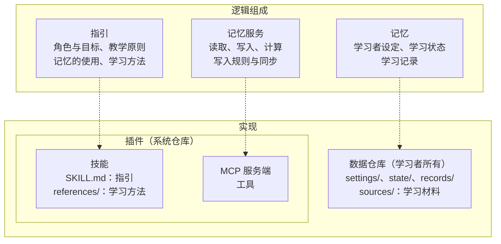

# Cairn 文档总览

本文件是 Cairn 文档的入口，说明系统的组成、文档的层次，以及每份文档回答的问题。

## Cairn 是什么

Cairn 是面向个人的 AI 辅助学习系统。它把与学习有关的记忆（学习者的设定、学习状态和学习记录）以纯文本保存在学习者自己的 git 仓库中，并向模型提供辅导的指引和读写记忆的工具。模型因此能够在了解学习者的基础上辅导；学习者更换客户端或模型后，学习可以从原有状态继续。

## 两个版本

本仓库同时包含两个版本的内容。

| 版本 | 形态 | 状态 | 文档 |
|---|---|---|---|
| 现行版本（v1） | 远程 MCP 服务，协作说明随工具返回 | 已实现 | 根目录的 [README.md](../README.md) 和 [DESIGN.md](../DESIGN.md)、[server/SPEC.md](../server/SPEC.md)、`harness/`、[DEPLOY.md](DEPLOY.md) |
| 基础版 | 客户端插件，由技能、MCP 服务端和数据仓库组成 | 详细设计中，尚未实现 | 本文件，以及下文“文档的层次”列出的各份文档 |

基础版是对系统的重新设计，只包含进行学习并在历次对话之间保持学习状态所需的最小要素，其他功能在其后作为扩展模块加入。基础版实现之前，v1 的文档和代码保持不变。本文件以下各节均针对基础版。

## 总体结构

系统由三个逻辑组成构成。**指引**告知模型如何辅导以及如何使用记忆；**记忆**保存与学习者有关的全部信息；**记忆服务**是模型读写记忆的唯一途径，并承担确定性的工作。在插件实现中，三者分别对应技能、MCP 服务端和数据仓库。下图上方是逻辑组成，下方是实现，虚线连接相互对应的要素。

| 逻辑组成 | 职责 | 实现 | 文档 |
|---|---|---|---|
| 指引 | 说明角色与目标、教学原则和记忆的使用方式 | 技能正文 `skills/cairn/SKILL.md` | [辅导](design/tutoring.md)、[技能](components/skill.md) |
| 学习方法 | 说明某一学习类型的常用安排，是指引的补充 | 技能参考文件 `skills/cairn/references/` | [辅导](design/tutoring.md)、[技能](components/skill.md) |
| 记忆服务 | 提供读取、写入和计算，保证写入规则，负责同步 | MCP 服务端及其工具 | [服务端](components/server.md) |
| 记忆 | 保存学习者设定、学习状态和学习记录 | 学习者的数据仓库（git） | [记忆](design/memory.md)、[数据仓库](components/data-repo.md) |
| 学习材料 | 课程、书籍、代码等原始材料，不属于记忆 | 数据目录下的 `sources/`，不纳入 git | [数据仓库](components/data-repo.md) |

技能和 MCP 服务端的连接声明打包为插件，随系统仓库发布，见[插件](components/plugin.md)。

三个部分通过三项约定衔接。

- 指引与记忆服务之间的约定是**工具接口**：指引说明何时读写记忆，工具说明各自的用途、参数和返回。
- 记忆服务与记忆之间的约定是**记忆格式**：目录结构、页面的 frontmatter 和链接语法。
- 指引与记忆之间的约定是**各类别的效力**：学习者设定等同于学习者的指令，学习状态是可以修订的判断，学习记录是事实。

这三项约定保持稳定时，任何一个部分都可以单独修改或替换。例如，可以用另一种语言撰写指引而不改动服务端，也可以更换记忆服务的存储方式而不改动指引。

## 文档的层次

文档分为五个层次，每个层次回答一类问题。

| 层次 | 回答的问题 | 文档 | 内容 |
|---|---|---|---|
| 总览 | 系统是什么，由什么组成，文档在哪里 | 本文件 | 系统的组成，文档的层次，术语 |
| 设计 | 为什么这样设计，依据什么目标、原理和模型 | [目标、边界与设计哲学](design/goals-and-principles.md) | 三项目标和判断标准；有意不采用的做法和当前版本的限制；设计取舍所依据的七条立场 |
| | | [辅导](design/tutoring.md) | 辅导的目标；教学原则及其依据；指引的写法；学习方法的定位 |
| | | [记忆](design/memory.md) | 记忆的三个类别及其效力；学习者设定的组织；页面、链接、索引和时间信息；记忆的更新方式 |
| 组成部分 | 每个部分提供什么，结构和接口是什么 | [技能](components/skill.md) | 技能的组成和加载方式；指引正文的草稿 |
| | | [服务端](components/server.md) | 记忆服务的职责；工具列表；服务端保证的规则 |
| | | [数据仓库](components/data-repo.md) | 目录结构、页面格式和格式版本 |
| | | [插件](components/plugin.md) | 插件包的结构；运行方式；各客户端的支持情况；版本；与 v1 的关系 |
| 实现 | 交给模型的正文、代码和模板是什么 | `skills/`、`server/`、`templates/data/` | 在基础版实现时建立或改写 |
| 过程 | 哪些内容已经确认，哪些是提案，哪些暂缓 | [议题与决策](decisions.md) | 设计的修改方式；各项议题的状态；暂缓的事项；后续步骤 |

一项内容归入哪个层次，按以下规则判断。

- 目标、原理、模型和取舍的理由写入设计层。设计层的内容不依赖具体的实现形式。
- 接口、结构和格式写入对应组成部分的文档。
- 交给模型的正文、代码和模板属于实现。文档说明它们的结构和依据，不重复它们的内容。
- 每项内容只在一处陈述，其他文档以链接引用。

`archive/` 目录保存已被取代的资料：[refactor-2026-10.md](archive/refactor-2026-10.md) 和 [cairn-handoff-2026-10.md](archive/cairn-handoff-2026-10.md)，是 2026 年 10 月插件化重构的讨论记录和交接说明。该方案已由基础版的设计取代，这两份资料不再更新，其中的结论不属于基础版；它们作为设计储备保留，对应的问题在实际使用中出现时可供参考。

## 术语

| 术语 | 含义 |
|---|---|
| 学习者 | 使用系统学习的人，也是数据仓库的所有者 |
| 模型 | 在客户端中进行辅导的 AI 模型 |
| 客户端 | 运行模型并加载插件的应用，例如 Claude Code、Claude 应用、ChatGPT |
| 对话 | 学习者与模型在客户端中的一次连续交流。系统不记录对话的开始和结束 |
| 对话标记 | 学习记录上的可选标注，表明哪些记录出自同一次对话 |
| 指引 | 告知模型如何辅导、如何使用记忆的正文，由技能提供 |
| 教学原则 | 指引中说明有效学习条件的各条原则，适用于所有学习类型 |
| 学习类型 | 学习活动的类别，例如课程、书籍 |
| 学习项目 | 一门课程、一本书、一个代码库或一个实践项目 |
| 学习方法 | 针对某一学习类型的常用安排，随插件提供，是指引的补充 |
| 记忆 | 系统保存的与学习者有关的全部信息，分为学习者设定、学习状态和学习记录 |
| 学习者设定 | 学习者对自身情况、目标和辅导方式所作的陈述与约定，效力等同于学习者的指令。按适用范围分为通用设定、类型设定和项目设定 |
| 学习状态 | 模型依据学习者的表现作出的判断，包括学习进度、掌握状态和学习特征 |
| 学习记录 | 学习过程中发生的事实，只追加 |
| 学习材料 | 课程、书籍、代码等原始材料，不属于记忆 |
| 页面 | 记忆的存取单位，即一个 Markdown 文件，长度不限 |
| 链接 | 页面之间以 `[[页面名]]` 表示的引用 |
| 索引 | 服务端生成的页面清单，包含名称、摘要和时间信息 |
| 时间信息 | 服务端为页面计算的首次记录、最近涉及、涉及天数和最近更新 |
| 阶段性更新 | 模型在学习的阶段性停顿处修订学习状态的工作 |
| 记忆服务 | 模型读写记忆的唯一途径，由 MCP 服务端实现 |
| 技能 | 客户端按需加载的说明文件及其参考文件，是指引的实现形式 |
| 插件 | 把技能、MCP 连接声明和可选的增强功能打包分发的形式 |
| 系统仓库 | 本仓库，包含插件、服务端源码、数据仓库模板和文档，不含个人数据 |
| 数据仓库 | 学习者自己的 git 仓库，保存其记忆 |
| 扩展模块 | 基础版之外、依据实际使用按需加入的功能 |

## 当前状态

基础版的设计议题已经全部确认，目前进行详细设计，包括指引定稿、记忆格式规格、工具规格以及课程与书籍的学习方法，尚未实现。各项议题的结论、暂缓的事项和后续步骤见[议题与决策](decisions.md)。
