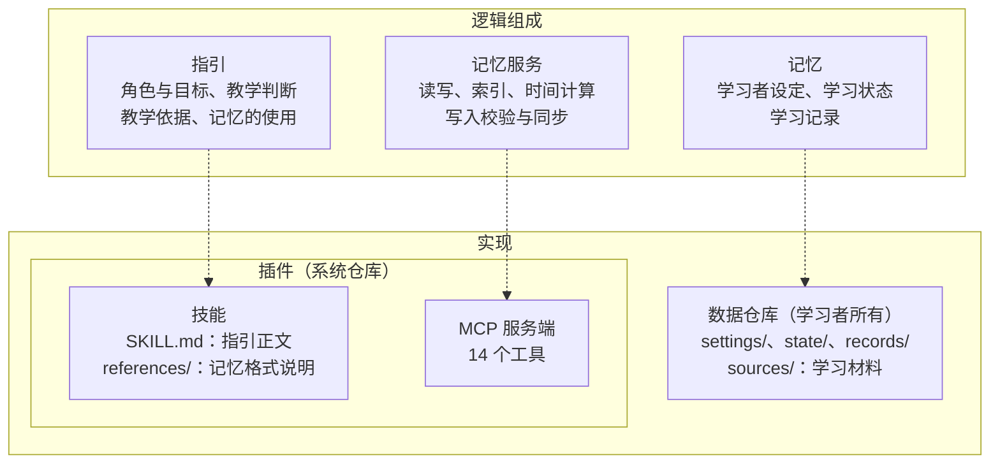

# Cairn 文档总览

本文件是 Cairn 文档的入口，说明系统的定位、逻辑组成与插件实现的对应关系、文档层次和核心术语。

## Cairn 是什么

Cairn 是面向个人的 AI 辅助学习系统。它把与学习者有关的长期记忆以纯文本保存在学习者自己的 git 仓库中，包括：
- 学习者的背景、目标与协作约定；
- 各学习项目的当前工作状态与已确定的安排；
- 对领域能力与个体学习特征的判断及其依据；
- 按时间追加的学习记录。

在此基础上，Cairn 向模型提供辅导指引和读写记忆的工具。模型结合学习者的目标与当前状态开展辅导，在互动中校准对学习者的认识，并将有持续价值的变化写回记忆。更换客户端或模型后，学习可以从已有状态接续。

## 两个版本

本仓库同时包含现行版本与重构中的基础版文档。

| 版本 | 形态 | 状态 | 文档 |
|---|---|---|---|
| 现行版本（v1） | 远程 MCP 服务，协作说明随工具返回 | 已实现 | 根目录的 [README.md](../README.md) 和 [DESIGN.md](../DESIGN.md)、[server/SPEC.md](../server/SPEC.md)、`harness/`、[DEPLOY.md](DEPLOY.md) |
| 基础版 | 客户端插件，由技能、MCP 服务端和数据仓库组成 | 设计定稿与评审中，尚未实现 | 本文件，以及下文“文档的层次”列出的各份文档 |

基础版是对系统的重新设计，只包含开展辅导并在历次对话之间维持连续性所需的最小组成，其余能力在试用后按实际需要作为扩展模块加入。基础版实现完成前，v1 的文档和代码保持不变。本文件以下各节均针对基础版。

## 总体结构

系统由三个逻辑部分构成：
- **指引**说明模型的导师角色、教学判断依据、权衡原则以及记忆的使用方式；
- **记忆**保存一位学习者的设定、当前状态和历史记录；
- **记忆服务**提供记忆与学习材料的读写接口，并承担确定性的计算、校验与同步。

在插件实现中，三者分别对应技能、MCP 服务端和数据仓库。下图上方为逻辑组成，下方为具体实现，虚线表示对应关系。

| 逻辑组成 | 职责 | 实现 | 文档 |
|---|---|---|---|
| 指引 | 说明导师角色、目标与权衡维度、教学依据及记忆读写准则 | 技能正文 [`skills/cairn/SKILL.md`](../skills/cairn/SKILL.md) | [学习模型](design/learning-model.md)、[辅导](design/tutoring.md)、[技能](components/skill.md) |
| 学习方法 | 说明适用条件明确、可跨学习者复用的专项辅导经验；基础版不预置独立文件 | 技能参考文件 `skills/cairn/references/` | [辅导](design/tutoring.md)、[技能](components/skill.md) |
| 记忆服务 | 提供存取、索引与页面时间计算，保证写入规则，执行本地提交与远端同步 | MCP 服务端及其工具 | [服务端](components/server.md) |
| 记忆 | 保存学习者设定、学习状态（进度、掌握状态、学习特征）和学习记录 | 学习者的数据仓库（git） | [记忆](design/memory.md)、[数据仓库](components/data-repo.md) |
| 学习材料 | 课程、书籍、论文、源码等原始材料及学习者作品，不属于记忆 | 数据目录下的 `sources/`，不纳入 git | [数据仓库](components/data-repo.md) |

技能与 MCP 连接声明打包为客户端插件，随系统仓库发布，兼容网页端远程连接与本地代理运行两种形态，见[插件](components/plugin.md)。

三个逻辑部分通过三项稳定约定衔接：
- **工具接口**连接指引与记忆服务：指引说明何时读取和更新记忆，工具定义具体的参数、返回与校验规则。
- **记忆格式**连接记忆服务与数据仓库：规定目录结构、页面 frontmatter、双链语法和学习记录条目格式。
- **内容的语义与效力**连接指引与记忆：区分学习者的决定、自述、观察和模型推断，明确只有学习者的决定在其有效范围内约束教学安排。

只要这三项约定保持稳定，任一部分都可以独立演进或替换。

## 文档的层次

文档分为五个层次，按读者与职责组织。

| 层次 | 回答的问题 | 文档 | 主要内容 |
|---|---|---|---|
| 总览 | 系统是什么，由什么组成，文档如何组织 | 本文件 | 系统组成、衔接约定、文档层次、核心术语 |
| 设计 | 为什么这样设计，依据什么目标、模型与取舍理由 | [目标、边界与设计哲学](design/goals-and-principles.md) | 规范陈述的三个层次；产品目标与可检查标准；核心不采用的做法与当前版本范围；七条设计哲学 |
| | | [学习模型](design/learning-model.md) | 学习目标的多元形态与使用条件；项目的切入与收敛；学习状态与差距；材料、任务、活动与支持的三个通用条件；表现、证据与归属；互动中的假设探测与补充活动；学习者参与判断与决定权阈值 |
| | | [辅导](design/tutoring.md) | 四组教学依据及其研究限度；互动中的状态探测与方式试探；AI 辅助研究及含义；材料条件、任务要求与工作区说明冲突；具体做法与学习方法；学习项目的过程 |
| | | [记忆](design/memory.md) | 各组成部分的独特价值与去重分工；四种语义与行动效力；写入、归属、淘汰重选与读取规则；设定、状态和记录；页面、双链、索引与页面更新时间信息；更新时机与跨对话延续 |
| 组成部分 | 每个部分的接口、文件结构与系统保证是什么 | [技能](components/skill.md) | 技能组成与加载时机；设计文档与指引的分工及出处映射；面向旗舰模型的提示词编写约定；场景走查检验 |
| | | [服务端](components/server.md) | 记忆服务职责；14 个工具；`start_session` 的返回（含掌握状态全量名称清单与新增记录提示）；对话标记；服务端保证的确定性规则与异步推送 |
| | | [数据仓库](components/data-repo.md) | 双仓库分离；目录结构；名称、frontmatter、正文、双链和记录的格式约定；完整示例；学习材料登记与格式版本 |
| | | [插件](components/plugin.md) | 插件包结构；本地与远程运行方式；网页端与本地客户端的兼容基线及增强层；通道分配；版本与开源要求 |
| 实现 | 实际提供给模型的文本、服务端代码与模板是什么 | [`skills/cairn/`](../skills/cairn/SKILL.md)、`server/`、`templates/data/` | 指引正文和记忆格式参考草稿已建立；服务端代码与数据模板在实现阶段改写 |
| 过程 | 哪些结论已确认，哪些属于当前定稿修订，哪些暂缓 | [议题与决策](decisions.md) | 修改规则；已确认结论与整合修订项；历史替代关系；暂缓扩展事项；后续步骤 |

内容归属遵循四条原则：
- **设计层**面向设计者、开发者与维护者，完整说明概念定义、研究依据及其适用边界、方案比较与取舍理由，不绑定单一客户端实现。
- **组成部分层**面向实现与维护，明确接口职责、文件规范与系统级保证。
- **实现层中的指引**面向运行时的模型，只保留会影响模型教学判断与工具使用的目标、权衡维度和系统契约，操作格式拆入按需读取的参考文件。
- **单一权威出处**：每项定义或规则在一处完整陈述，其余文档通过链接引用。

`archive/` 目录保存已被取代的早期资料：[refactor-2026-10.md](archive/refactor-2026-10.md) 和 [cairn-handoff-2026-10.md](archive/cairn-handoff-2026-10.md)，作为历史记录与设计储备保留，不作为基础版依据。

## 术语

| 术语 | 含义 |
|---|---|
| 学习者 | 使用系统学习的人，也是个人数据仓库的所有者 |
| 模型 | 在客户端中承担辅导工作的 AI 模型 |
| 客户端 | 运行模型并接入插件的应用，包括网页端（如 ChatGPT、Claude 网页与移动应用）和本地代理（如 Claude Code、Codex） |
| 对话 | 学习者与模型在客户端中的一次连续交流；系统不依赖对话开始或结束事件维持状态 |
| 对话标记 | 学习记录条目上的可选短标记，用于标识出自同一次对话的记录 |
| 学习模型 | 系统描述学习与辅导过程的基础概念关系：学习目标、当前状态与差距、活动与支持、表现与证据 |
| 学习目标 | 学习者希望通过学习获得的结果，如建立结构性理解、在预期条件下形成某项能力，或在解决具体问题中按需补足认识 |
| 使用条件 | 目标指向可运用的能力时，该能力预期发挥作用的任务情境、允许借助的资料与工具、需自行承担的关键判断，以及保持或迁移要求 |
| 支持条件 | 一次学习活动中实际提供或使用的帮助，包括讲解、示范、提示、模型顺势补全的推理、参考资料与工具 |
| 差距 | 相对于特定学习目标，学习者当前表现与目标要求之间的距离；属于随目标和证据变化的判断 |
| 学习项目 | 围绕一组相关目标、材料或任务开展的一段持续学习，如一门课程、一本书、一个代码库或一个实践项目 |
| 学习材料 | 教材、讲义、论文、源码、实验数据及学习者作品等分析或学习对象，存放在 `sources/`，不属于记忆 |
| 任务 | 当前需要回答的问题或完成的具体要求 |
| 学习活动 | 学习者实际进行的阅读、回忆、解释、预测、比较、设计、实现、调试、梳理等思考与行动 |
| 支持 | 为学习活动提供的外部帮助 |
| 表现 | 学习者在具体条件下作出的回应、提问、选择、操作及其结果 |
| 证据 | 对某项能力或特征判断具有支持或修正意义的表现及其发生条件 |
| 指引 | 告知模型如何开展辅导与读写记忆的主提示文本，由 `SKILL.md` 提供 |
| 教学依据 | 由学习科学研究归纳出的学习发生条件及其教学推论 |
| 学习方法 | 写明适用问题、条件与调整依据的可复用专项辅导参考；基础版不预置独立文件 |
| 记忆 | 系统保存的个人信息，由学习者设定、学习状态和学习记录组成 |
| 学习者设定 | 学习者的背景自述、学习目标与持续协作约定，分为通用设定和项目设定 |
| 学习状态 | 对当前情况的概括认识，分为学习进度、掌握状态和学习特征三类页面 |
| 学习进度 | 单个学习项目的进展概况、当前工作状态（位置、已开展步骤与当前分析认识）、学习者要求保留的备忘及已确定的下一步安排 |
| 掌握状态 | 按可复用概念、机制或能力组织的当前能力边界判断及其依据 |
| 学习特征 | 带观察范围、随新表现修订的跨内容认知与辅导假设 |
| 学习记录 | 按日期归档的只追加事件记录，保存学习过程中的尝试、反应、支持、决定与变更 |
| 决定与约定、自述、观察、推断 | 记忆内容的四种语义；仅学习者的决定在其有效范围内约束教学安排 |
| 页面 | 记忆的存取单位，对应一个带 `summary` frontmatter 的 Markdown 文件 |
| 链接 | 以 `[[页面名]]` 表示的引用，用于页面间的语义关联、相关背景召回与 Obsidian 跳转 |
| 索引 | 服务端生成的页面目录，包含页面名称、摘要与时间信息 |
| 时间信息 | 服务端依据状态页面内容写入提交（`write_page`、`edit_page`）计算的首次创建日期、最近更新日期和累计更新天数 |
| 阶段性更新 | 在局部学习告一段落或准备离开时，模型将观察写入记录并同步修订相关学习状态页面的操作 |
| 记忆服务 | 模型读写记忆与材料的唯一通道，由 MCP 服务端实现 |
| 系统仓库 | 公开仓库，包含插件、服务端源码、数据模板与设计文档，不含个人数据 |
| 数据仓库 | 学习者私有的 git 仓库，保存个人记忆 |

## 当前状态

本分支在学习模型重构与多轮交叉评审结论的基础上，完成了设计文档、组件规范、指引正文与记忆格式参考的整合修订。各项决策的确认状态、历史替代关系及后续步骤见[议题与决策](decisions.md)。
