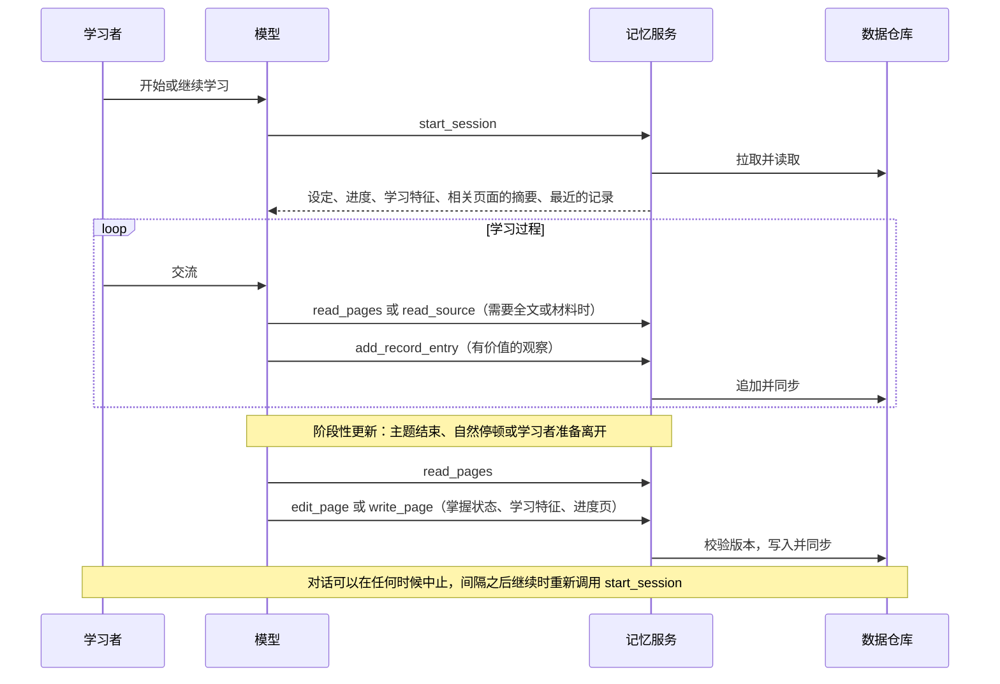

# 服务端

本文说明记忆服务的职责、工具和服务端保证的规则。模型通过由 MCP 服务端实现的记忆服务读写记忆；记忆的类别、页面和更新方式见[记忆](../design/memory.md)，数据仓库的目录和格式见[数据仓库](data-repo.md)。各部分的确认状态见[议题与决策](../decisions.md)。

本文给出工具的划分和各自的用途。每个工具的参数、返回结构、错误情形和工具说明的文字属于工具规格，在详细设计阶段确定，写入 `server/SPEC.md`。

## 职责

服务端承担三类工作。

- **存取**：读取和写入数据仓库中的页面与学习记录，读取学习材料。
- **确定性的计算**：记录时间和对话标记，解析链接，生成索引，计算时间信息，校验版本。
- **规则与同步**：保证下文“服务端保证的规则”中的各项规则；数据仓库有多个副本时，通过 git 远端使它们保持一致。

服务端返回记忆内容、时间信息和文件变化等系统信息。记忆中的选择、自述、观察和推断保留各自的性质，模型依据指引解释和使用。服务端的存取与计算独立于具体教学判断。

各工具的行为由调用参数和数据仓库的当前内容确定。对话标记作为标注随学习记录写入，见下文“对话标记的取得”。

## 工具

记忆服务提供 14 个工具，分为六组。工具按模型的意图划分，例如加载记忆、记录观察、修订判断；工具说明只描述用途、参数和返回。

| 分组 | 工具 | 用途 | 主要参数 | 返回 |
|---|---|---|---|---|
| 加载 | `start_session` | 加载开始辅导所需的记忆。只读，可以重复调用 | `project`、`conversation`（均可选） | 见下文“start_session 的返回” |
| 学习记录 | `add_record_entry` | 向学习记录追加一条观察 | `text`、`project`（可选）、`conversation`（可选） | 写入的时间和对话标记；链接所指向的页面中尚不存在的名称 |
| 读取 | `read_pages` | 读取一个或多个页面的全文 | `names` | 页面内容、版本标识、时间信息 |
| 读取 | `list_pages` | 列出页面的名称、摘要和时间信息 | `category`、`project`、`sort`（均可选） | 索引条目 |
| 读取 | `search_memory` | 在页面和学习记录中全文检索 | `query`、`category`（可选） | 命中的页面和上下文片段 |
| 读取 | `get_related_pages` | 获取与指定页面相互链接的页面 | `name`、`depth`（可选） | 相关页面的名称、摘要和时间信息；涉及该页面的学习记录 |
| 学习状态 | `write_page` | 新建学习状态页面，或整页重写 | `name`、`kind`、`content`、`summary`、`base_version`（重写时） | 新的版本标识；版本不一致时不写入，返回当前内容 |
| 学习状态 | `edit_page` | 对学习状态页面作局部修改 | `name`、`edits`、`base_version`、`summary`（可选） | 同上 |
| 学习状态 | `move_page` | 重命名页面，并更新所有指向它的链接 | `name`、`new_name` | 被更新的页面 |
| 学习状态 | `remove_page` | 删除页面；合并页面时指定替代页面，原有链接改为指向它 | `name`、`redirect_to`（可选） | 被更新的页面 |
| 学习者设定 | `update_settings` | 新建或修改学习者设定中的页面 | `page`、`content` 或 `edits`、`confirmation` | 新的版本标识 |
| 学习材料 | `list_sources` | 列出某个学习项目的学习材料 | `project`、`subpath`（可选） | 文件清单；PDF 附页数和目录 |
| 学习材料 | `read_source` | 读取学习材料 | `project`、`path`、`pages`（可选） | 文本内容，或 PDF 的指定页 |
| 学习材料 | `fetch_materials` | 把公开的学习材料下载到该项目的材料目录 | `project`、`urls` | 下载结果 |

有三点说明。

- `write_page` 的 `kind` 指明页面的种类：学习进度、掌握状态或学习特征。新建学习项目不设单独的工具：新建该项目的进度页时，服务端同时建立同名的材料目录。
- 读取有四种方式，分别按名称、按索引、按检索和按关联。时间信息随 `start_session`、`read_pages`、`list_pages` 和 `get_related_pages` 的返回提供；`list_pages` 可以按距上次涉及的时间排序，便于模型查找间隔较长的内容。
- 工具说明控制在较短的篇幅内，不含教学要求。部分客户端按需加载工具说明，工具数量的增加不会等比例增加上下文开销；各客户端的实际行为在实现阶段实测。

## start_session 的返回

`start_session` 返回模型开始辅导所需的信息，分为七个部分。它不写入任何内容，开始学习时调用，对话在间隔一段时间后继续时可以再次调用。

1. **当前时间。** 取自服务端时钟。
2. **学习者设定。** 通用设定的全文。指定了学习项目时，加上该项目的项目设定；其余项目设定返回名称和摘要。其他适用范围的加载映射在详细设计中确定，见[议题与决策](../decisions.md)。
3. **学习进度。** 指定了学习项目时，返回该项目的进度页；没有指定时，返回各学习项目的名称、摘要和最近活动的时间。
4. **学习特征和相关的学习状态。** 学习特征页面的全文。相关的掌握状态页面由进度页和近期学习记录中的链接确定，返回其名称、摘要和时间信息；其余页面只返回数量。需要全文时，模型用 `read_pages` 读取。
5. **最近的学习记录。** 最近一个有记录的日期中的条目；指定了学习项目时，只取该项目的条目。
6. **状态与材料的变化。** 被学习记录涉及之后尚未更新的学习状态页面；最近一条学习记录之后被学习者直接修改过的页面；学习材料的变化（新增、更新、缺失）。
7. **对话标记。** 请求中没有客户端提供的对话标识时，返回本对话的标记：调用时带有 `conversation` 的沿用该值，没有带的新生成一个短标记。

相关页面按链接选取，返回的内容量因此不随记忆的增长而等比例增加。

## 对话标记的取得

学习记录上的对话标记（见[记忆](../design/memory.md)中“更新与跨对话延续”）由服务端在 `add_record_entry` 写入时确定，按以下顺序取得。

1. 客户端的请求中带有对话标识时，使用该标识。
2. 调用的 `conversation` 参数有值时，使用该值。它由插件的钩子填入，或者是模型带上的、由 `start_session` 发放的标记。
3. 两者都没有时，这条记录不带标记。

发放标记不产生需要保存的内容。`start_session` 生成的短标记只随结果返回，服务端不保存它，也不校验 `conversation` 的取值是否由它发放；`start_session` 因此仍然是只读的。标记写入记录之后，`add_record_entry` 在返回中重复给出它，便于模型在长对话中继续带上。

MCP 协议本身不提供对话标识。协议的 2026-07-28 版本移除了协议层的会话和 `Mcp-Session-Id`，规定服务端不得把连接或进程视为对话，需要跨调用关联时使用由服务端发放、作为普通工具参数传递的标识（见协议的[基础部分](https://modelcontextprotocol.io/specification/2026-07-28/basic/index)和[变更说明](https://modelcontextprotocol.io/specification/2026-07-28/changelog)）。上述做法与此一致。

各客户端提供对话标识的方式见[插件](plugin.md)中“各客户端的支持情况”。标记在记录中的写法见[数据仓库](data-repo.md)中“学习记录”：标记固定为 6 个字符，客户端提供的对话标识写入由它计算出的摘要。

## 服务端保证的规则

以下规则由服务端保证，不依赖模型的配合。

| 规则 | 保证方式 |
|---|---|
| 学习记录只追加 | 不提供修改或删除记录条目的工具；`add_record_entry` 只在当日记录的末尾追加 |
| 设定写入保留确认依据 | 只有 `update_settings` 可以写入 `settings/`；调用时须在 `confirmation` 中说明学习者确认的内容，该说明写入提交信息 |
| 学习状态的写入不相互覆盖 | 重写和修改须提供读取时得到的版本标识；版本不一致时不写入，返回当前内容由模型重新处理 |
| 每个页面都有摘要 | 新建和重写页面时须提供 `summary`，否则不写入 |
| 每次写入即提交 | 写入在服务端串行执行，写入后只提交本次改动的文件。配置了 git 远端时，写入前拉取，写入后推送；推送失败时在返回中说明 |
| 时间由服务端确定 | 学习记录的条目时间和各项时间信息均取自服务端时钟和 git 历史 |
| 对话标记可以缺失 | 没有取得对话标记时，记录照常写入；标记只决定记录上的这一项标注，不影响各工具的其他行为 |
| 名称和路径合法 | 学习状态页面的名称在 `state/` 内唯一；读写范围限于数据目录 |
| 格式版本一致 | 启动时检查 `FORMAT_VERSION`，与服务端支持的版本不一致时拒绝启动 |
| 工具结果保留内容性质 | 返回原有记忆内容及时间、文件变化等系统信息；记忆中的约定、自述、观察和推断按原意提供 |

`confirmation` 由模型依据学习者已表达的选择填写，服务端校验其已填写并保存于提交历史。确认是否成立由实际交流决定，学习者可以核对写入内容及其依据。这体现了[目标、边界与设计哲学](../design/goals-and-principles.md)中“记忆能够由学习者阅读和核对”的要求。

多个对话同时进行时，上述规则同样适用，不需要另外的机制。数据仓库有多个副本（例如本机和服务器各一份）并且同时向同一天的学习记录追加时，同步采用保留双方条目的合并方式。

## 调用的时序

下图是一次学习中工具调用的典型顺序。图中没有列出 `list_pages`、`search_memory`、`get_related_pages`、`list_sources` 和 `fetch_materials`，它们在需要浏览索引、检索或处理学习材料时使用。图中的拉取和同步只在配置了 git 远端时进行（见[插件](plugin.md)中“运行方式”）。

## 与 v1 工具的对应

| v1 的工具 | 基础版的处理 |
|---|---|
| `start_session` | 重写，返回内容见上文；指引改由技能提供，不再随工具结果返回 |
| `list_sources`、`read_source`、`fetch_materials` 和新材料检测 | 保留；参数 `resource` 改称 `project` |
| `write_log`、`read_logs`、`search_logs` | 由 `add_record_entry`、`read_pages` 和 `search_memory` 取代 |
| `update_progress`、`read_progress`、`write_concepts` | 由通用的页面工具取代 |
| `read_standard` | 取消；格式说明改为技能的参考文件 |

服务端的其他部分与 v1 的关系见[插件](plugin.md)中“与 v1 的关系”。

