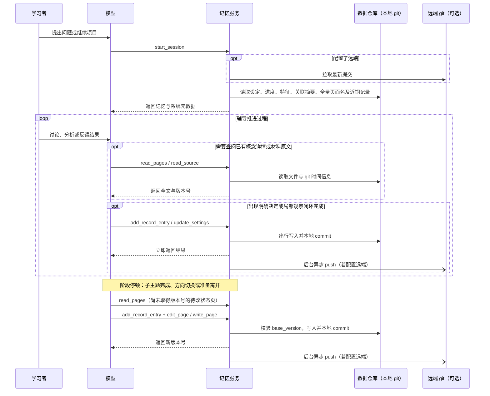

# 服务端

本文说明记忆服务的职责、工具划分、`start_session` 的返回结构、对话标记取得方式以及服务端保证的确定性规则。记忆服务由 MCP 服务端实现，是模型读写个人记忆与静态学习材料的唯一接口；记忆的语义与更新机制见[记忆](../design/memory.md)，数据仓库的目录与文件规范见[数据仓库](data-repo.md)。

本文界定各工具的职责与契约边界；具体参数结构、返回字段、错误码与工具说明文本属于工具详细规格，在实现前写入 `server/SPEC.md`。

## 职责

服务端承担三类确定性工作：
- **存取**：读写数据仓库中的设定页面、状态页面与学习记录，读取 `sources/` 中的学习材料。
- **确定性计算与索引**：记录条目写入时间与对话标记，解析页面双链，生成包含掌握状态页面名称目录的索引，依据页面 git 内容变更历史（排除重命名与双链改写提交）计算页面时间信息，校验并发版本，提供上次状态写入提交（`write_page` / `edit_page`）后新增的学习记录与材料变动信息。
- **规则校验与仓库同步**：强制执行下文的写入规则；本地写入立即生成 git 提交，配置了 git 远端时在读取前拉取、写入后在后台异步拉取合并并推送。

服务端不解析页面的教学含义，也不在工具返回中夹带面向模型的行为指令。工具返回仅包含两类信息：
- 原样提供的记忆与材料内容（保留其原有的来源与语义）；
- 系统确定性元数据（当前时间、页面时间信息、新增记录列表、文件变更与版本标识）。

服务端不维护与特定对话绑定的内存状态，各工具的行为仅取决于调用参数与数据仓库的当前内容。

## 工具

记忆服务提供 14 个工具，按操作意图分为六组。工具说明只陈述接口用途、参数和返回格式，不写入教学要求。

| 分组 | 工具 | 用途 | 主要参数 | 返回 |
|---|---|---|---|---|
| 加载 | `start_session` | 加载开始或继续辅导所需的记忆与索引概况；只读，可重复调用 | `project`、`conversation`（均可选） | 见下文“`start_session` 的返回” |
| 学习记录 | `add_record_entry` | 向当日学习记录追加一条事件、观察或决定变更 | `text`、`project`（可选）、`conversation`（可选） | 写入的时间与对话标记 |
| 读取 | `read_pages` | 读取一个或多个设定页或状态页的全文 | `names` | 页面全文、当前版本标识、页面时间信息 |
| 读取 | `list_pages` | 按类别、项目或时间排序列出状态页面的索引信息 | `category`、`project`、`sort`（均可选） | 页面名称、摘要与时间信息列表 |
| 读取 | `search_memory` | 在设定、状态页面和学习记录中全文检索 | `query`、`category`（可选） | 命中的页面或记录片段及日期 |
| 读取 | `get_related_pages` | 获取与指定页面通过双链相互关联的页面及相关记录 | `name`、`depth`（可选） | 关联页面的名称、摘要与时间信息；包含该页面名称或双链的学习记录片段 |
| 学习状态 | `write_page` | 新建学习状态页面，或整页重写已有状态页面 | `name`、`kind`、`content`、`summary`、`base_version`（重写时必填） | 新版本标识；版本不匹配时拒绝写入并返回最新内容 |
| 学习状态 | `edit_page` | 对已有学习状态页面作局部替换修改 | `name`、`edits`、`base_version`、`summary`（可选） | 同上 |
| 学习状态 | `move_page` | 重命名或移动状态页面，并同步改写仓库内所有指向它的双链 | `name`、`new_name` | 受影响并完成更新的页面与记录文件清单 |
| 学习状态 | `remove_page` | 删除状态页面；合并页面时指定 `redirect_to`，将原有双链改写为指向目标页 | `name`、`redirect_to`（可选） | 受影响并完成更新的文件清单 |
| 学习者设定 | `update_settings` | 新建或修改学习者设定页面 | `page`（`general` 或 `projects/<学习项目>`）、`content` 或 `edits`、`confirmation` | 新版本标识 |
| 学习材料 | `list_sources` | 列出指定学习项目材料目录下的文件结构 | `project`、`subpath`（可选） | 文件清单；PDF 附带页数与目录信息 |
| 学习材料 | `read_source` | 读取指定学习材料的内容 | `project`、`path`、`pages`（可选） | 文本全文，或 PDF 指定页内容 |
| 学习材料 | `fetch_materials` | 将公开 URL 的学习材料下载至该项目的材料目录 | `project`、`urls` | 下载保存结果 |

补充说明：
- **设定与状态页面的命名空间隔离**：设定页面统一通过 `general` 或 `projects/<学习项目>` 指定，与 `state/` 下的状态页面分开标识，避免项目设定 `projects/cs336` 与进度页 `cs336` 混淆。
- **新建项目无单独工具**：首次用 `write_page`（`kind="progress"`）创建某学习项目的进度页时，服务端自动建立同名的 `sources/<学习项目>/` 目录。
- **排序与间隔查询**：`list_pages` 支持按最近更新日期升序或降序排列，便于模型查看间隔较久未曾更新的状态页面。

## `start_session` 的返回

`start_session` 为只读操作，在对话开始学习、中途确定或切换学习项目、或间隔较长时间后续接对话时调用。返回内容由七部分组成：

1. **当前时间**：取自服务端配置时区的系统时钟。
2. **学习者设定**：`settings/general.md` 全文；指定了 `project` 时一并返回 `settings/projects/<学习项目>.md` 全文（若存在），其余项目设定仅返回名称与摘要；未指定 `project` 时返回各项目设定的名称与摘要。
3. **学习进度**：指定了 `project` 时返回 `state/progress/<学习项目>.md` 全文及版本标识；未指定时返回所有学习项目的名称、摘要与最近更新日期。
4. **学习特征与掌握状态目录**：
   - `state/traits/` 下学习特征页面的全文（特征保持精炼；页面较多时模型可按摘要与正文管理）；
   - 与当前项目直接关联的掌握状态页面（由当前进度页中的 `[[双链]]` 解析得出），返回其名称、`summary` 摘要与三项时间信息；
   - **其余全部掌握状态页面的轻量名称清单（含页面名称与最近更新日期，不含摘要与全文）**。提供全量名称清单使模型在进入新项目时即可看见过往积累的全部概念与能力页面，按需调用 `read_pages` 查阅详情，并沿用既有准确名称打双链，防止同义页面重复创建。
5. **最近的学习记录**：最近一个有记录日期中的条目（指定 `project` 时默认过滤该项目及无项目归属的通用条目）。
6. **状态与材料的变化**：
   - **上次状态写入后新增的学习记录**：服务端比对 `records/` 条目时间与 `state/` 最近一次由 `write_page` 或 `edit_page` 产生的提交时间，客观列出晚于该基准时间的记录条目（排除 `move_page`、`remove_page` 及学习者直接编辑提交对基准时间的干扰）；
   - **学习者直接编辑过的页面**：最近一次工具写入之后由学习者在本地直接修改过的页面名称；
   - **学习材料变化**：相对于进度页已登记路径的新增文件、修改时间晚于进度页的已登记文件，以及已缺失的路径。
7. **对话标记**：请求上下文中无客户端自带会话标识时，若调用参数传入了 `conversation` 则原样沿用，否则新生成一个 6 位短标记返回。

## 对话标记的取得

`add_record_entry` 写入记录时，按以下优先级确定条目上的 6 位对话标记：
1. 客户端请求元数据中自带会话标识（如 ChatGPT 的 `_meta["openai/session"]`、Codex 的 `_meta.sessionId`）时，取该标识计算出的 6 位固定摘要；
2. 工具参数 `conversation` 非空时（由本地客户端钩子自动注入客户端会话 ID，或由模型传入 `start_session` 发放的短标记），若为长标识则取 6 位摘要，若已为 6 位短标记则直接使用；
3. 两者均无时，以 `-` 占位，记录正常写入。

服务端不持久化存储已发放的短标记，也不校验其归属，`start_session` 保持纯只读性质；`add_record_entry` 在返回结果中回显本次使用的标记，降低长对话中丢失参数的概率。这一设计与 MCP 协议（2026-07-28 版移除协议层会话绑定、改由应用层显式传递关联参数）保持一致。

## 服务端保证的规则

以下不变量由服务端代码直接保证，不依赖模型自律：

| 规则 | 服务端保证方式 |
|---|---|
| 学习记录只追加 | 不提供删除或覆写记录条目的工具；`add_record_entry` 仅在当日文件末尾追加；页面重命名或合并时仅同步替换记录中的目标双链文本 |
| 设定修改必附确认依据 | 仅 `update_settings` 可写入 `settings/`；强制检查 `confirmation` 非空，并将其写入 git commit 消息供核查 |
| 状态并发写入不静默覆盖 | 重写或局部编辑 `state/` 页面必须传入读取时获得的 `base_version`；版本不一致时拒绝写入并返回磁盘最新内容与新版本号 |
| 页面必有单行摘要 | 新建或重写页面时校验 `summary` 存在、单行且不超过 200 字符 |
| 本地同步提交、远端异步推送 | 写操作在服务端进程内串行加锁执行，落盘后立即完成本地 `git commit` 并返回工具结果；配置了 git 远端时，`start_session` 前执行拉取，写操作后在后台异步执行拉取合并与 `git push`（记录合并保留双方追加条目，状态页冲突或推送失败暂存并在下一次工具返回中说明） |
| 页面时间排除机械改写提交 | 记录条目时间取自服务端时钟；各状态页面的首次创建日期、最近更新日期和累计更新天数由服务端从文件 git 提交历史（启用 `--follow`）中统计内容变更提交得出，**排除 `move_page`、`remove_page` 的重命名与双链改写提交**（保留 `write_page`、`edit_page` 及学习者直接修改页面内容的提交），也不因读取工具调用而改变 |
| 提供状态写入后的新增记录 | `start_session` 通过比对 `records/` 条目时间与 `state/` 最近一次由 `write_page` 或 `edit_page` 产生的提交时间，列出晚于该基准时间的记录作为近期变动线索 |
| 命名唯一与路径隔离 | 校验 `state/` 内页面名称不区分大小写全局唯一，禁止路径穿越字符，所有文件访问严格限制在配置的数据目录内 |
| 格式版本一致 | 启动时校验数据仓库根目录的 `FORMAT_VERSION`（基础版为 `2`），不匹配时拒绝启动并提示迁移 |
| 工具结果不夹带行为指令 | 返回结果仅含原始记忆文本、材料内容与确定性系统元数据 |

多副本同步冲突处理：当本地与远端同时使用并通过 git 远端同步时，若两端在同一天向同一个 `records/YYYY-MM-DD.md` 追加了记录，拉取合并策略保留双方的追加条目并按时间排列。

## 典型调用时序

下图展示一次常规辅导中的工具调用关系。日常多轮交流中无需每轮调用写入工具；学习者作出明确决定时当场记录，局部观察闭环完成或进入阶段停顿时一并追加记录与更新状态页，远端推送在后台异步完成。

## 与 v1 工具的对应关系

| v1 工具 | 基础版的调整 |
|---|---|
| `start_session` | 重写返回结构：指引迁入技能正文；新增掌握状态全量名称清单、排除机械改写提交的页面时间信息，以及最近一次 `write_page` / `edit_page` 之后新增的记录列表 |
| `list_sources`、`read_source`、`fetch_materials` | 保留，参数 `resource` 统一更名为 `project` |
| `write_log`、`read_logs`、`search_logs` | 由 `add_record_entry`、`read_pages`（或记录读取）与 `search_memory` 取代 |
| `update_progress`、`read_progress`、`write_concepts` | 合并为通用的状态页面读写与重命名工具（`write_page`、`edit_page`、`move_page`、`remove_page`） |
| `read_standard` | 取消，记忆格式说明改为技能下的按需参考文件 `references/memory-format.md` |
