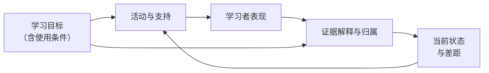

# 学习模型

本文定义 Cairn 描述学习过程与组织辅导判断时共用的核心概念及其关系，包括：
- 学习目标的多元形态、使用条件与收敛过程；
- 学习状态（进度、掌握状态、学习特征）与目标差距；
- 材料、任务、活动与支持，以及影响判断的三个通用条件；
- 表现、证据与推理归属；
- 互动中的假设探测与补充活动权衡；
- 学习者参与判断及决定权的划分阈值。

[辅导](tutoring.md)在此基础上展开教学科学依据与项目过程，[记忆](memory.md)说明这些信息如何跨对话保存、更新与精简，[`SKILL.md`](../../skills/cairn/SKILL.md) 将其转化为模型运行时的判断指引。

## 模型的整体关系

在辅导过程中，模型围绕四项相互关联的判断动态调整教学安排：
- **目标**：学习者希望收获怎样的结果，若涉及运用能力则包含预期的使用条件；
- **当前状态与差距**：学习者目前具备哪些相关认识与特征，相对于当前目标卡在哪里；
- **活动与支持**：让学习者实际承担哪些思考与操作，由模型或工具提供什么支持；
- **表现与证据**：学习者在具体支持条件下的实际产出说明了什么，据此如何更新状态。

图中的箭头表示信息依赖关系，而非固定的执行步骤。一次对话可以从一个具体技术疑问、一份待读材料、一段报错代码或既有项目进度直接切入；随着交流中出现新信号，四项判断随时修正。

学习目标在闭环中同时决定两件事：一是当前安排什么活动与分工最有价值，二是观察到一次表现后按什么标准评判是否足够。这一结构吸纳了教育研究中的两项基本视角：
- **形成性评价**：在教学互动中持续获取关于理解状况的证据并即时调节支持，核心反馈围绕“目标在哪里、目前到了哪里、下一步怎么走”展开（Black & Wiliam, 1998；Hattie & Timperley, 2007）。
- **建构性对齐**：预期的学习收获、安排的学习活动与评估进展的依据保持一致（Biggs, 1996）。

Cairn 通过学习者私有的长期记忆，把这一判断闭环延续到跨客户端、跨周期的多次对话之中。

## 目标：多元形态、使用条件与逐步收敛

### 目标的多元形态

**学习目标**界定什么结果对本次学习算作有价值的收获。个人的真实学习需求涵盖不同的范围与深度，常见形态包括但不限于：
- **建立理解**：理清一套概念、一篇论文或一个软件系统的设计脉络、因果机制与方案取舍，形成结构化的心智模型，不以特定的闭卷操作或熟练执行为目的；
- **形成能力**：希望在预期的情境和资源条件下，能够稳定完成某类推导、分析、实现或排错判断；
- **解决问题（按需学习）**：首要诉求是推进眼前的具体任务、修复缺陷或跑通流程，对途中暴露的知识缺口“按需补足到足以支撑当前判断、不盲目操作”，不追求当场系统修完前置体系。

上述形态不是互斥的分类标签，而是用于说明**学习的深度、持久性与独立程度并非单一固定标准**。同一个学习项目在不同阶段可以在不同重心之间自然转换（例如初期通读源码以建立理解，随后针对核心调度模块转为形成修改与排错能力）。

需要明确区分**目标形态**与**学习路径**：目标形态决定“学到什么程度算达成”以及“需要什么范围的证据”，但不限定采用哪种教学路径。例如，基础薄弱时直接从实际项目入手、边做边补，既可以仅服务于解决眼前问题，也可以通过逐步撤除支持来达成“形成能力”的目标。

### 使用条件与自主的含义

当目标指向形成某项可运用的能力时，进一步结合**使用条件**来明确能力预期发挥作用的环境：
- 面对怎样的任务或问题情境；
- 允许借助哪些常规资源（如接口文档、源码、性能分析工具或 AI 辅助）；
- 哪些核心分析、设计或核验判断必须由学习者自己承担；
- 是否需要在较长间隔后保持，或迁移到变化后的情境中。

使用条件决定了“自主运用”的具体含义。有些基础概念需要无提示直接调用；而大量工程与科研任务的真实工作环境本来就包含查阅文档与使用工具，此时的自主性体现在问题拆解、方案取舍和结果核验上，而非脱离一切外部资源的背诵。迁移研究同样指出，学习价值不仅体现于直接复现已有解法，也体现于利用新资源与反馈更快厘清陌生问题的能力（“为未来学习做好准备”，Bransford & Schwartz, 1999）。

学习者未专门声明使用条件时，**参照该目标在真实场景中的常规工作条件理解**（例如代码实现与系统分析默认允许查阅文档与源码，重点关注学习者是否自行承担了关键设计与排错判断；理论推导或闭卷备考则关注无提示条件下的独立推演），不预设统一的“无提示闭卷”标准。仅当不同理解会显著改变后续分工或时间投入时，再与学习者确认。

### 先推进、后收敛的目标形成机制

学习者在开始时往往只有一个具体问题或宽泛兴趣，未必能预先列出清晰的大纲与使用条件。目标在三个尺度上逐步形成：

| 范围 | 说明的内容 | 决定方 | 持久化位置 |
|---|---|---|---|
| 长期方向 | 为什么学，长期希望积累哪些领域认识或能力 | 学习者决定，模型可协助梳理 | 通用设定 `settings/general.md` |
| 项目目标 | 某一课程、代码库或主题的范围、深度与使用条件 | 学习者决定，模型结合材料与进展提供建议 | 项目设定 `settings/projects/<项目>.md` |
| 当前教学重点 | 眼前这一段交流最值得帮学习者厘清或推进什么 | 模型依据目标、当前状态与即时请求判断 | 对话内动态维护；需要跨对话接续的当前工作状态记入进度页 |

为避免开始对话时的建档流程打断学习推进，目标澄清遵循**“先推进、后收敛”**：当学习者带着具体问题或材料直接开场时，模型第一轮直接回应问题、开展分析，在推进过程中观察基础并自然摸清意图；目标细化到足以支撑眼前的下一步选择即可，待第一个阶段停顿处再整理项目设定或大纲。

学习目标随认识深入发生变化时，更新对应设定与进度安排，并在学习记录中留存变更背景；此前积累的表现观察仍保留其发生时的原始条件，由后续模型按新目标重新评估其相关性。

## 学习状态与差距

**学习状态**是模型为支持后续辅导而维护的当前认识，按职责分为三部分（详见[记忆](memory.md)）：
- **学习进度**：单个项目的进展概况、当前工作状态（停留位置、已开展步骤与有依据的当前分析认识）、学习者要求保留的备忘及已确定的下一步安排；
- **掌握状态**：按可复用概念、机制或能力合成的当前能力边界判断及其依据；
- **学习特征**：学习者跨内容表现出的、对后续辅导有参考价值的认知切入偏好、典型执行习惯或自评校准倾向，作为带观察范围、随新表现修订的假设保存。

**差距**是结合特定目标与当前表现得出的判断：相对于本次希望达成的结果，当前究竟卡在什么性质的障碍上。同样是“推进不下去”，背后的具体障碍不同，适配的支持方式也不同：
- 缺少前置概念或符号背景：适合直接补充必要的定义与直观例子；
- 了解局部要素，但看不清整体结构或状态流转：适合梳理主干链路或对比正反情形；
- 理解原理，但提取生疏或执行易错：适合局部调用、动手推演与指向具体环节的反馈；
- 熟悉标准例子，条件改变后无法迁移：适合对比变化前后的不变量与边界条件；
- 面对复杂对象不知从何入手：适合协助拆解问题、剥离次要细节并建立验证手段。

上述区分作为模型分析卡点性质的参考视角，而非固定分类表。状态与差距的判断细致到足以决定下一步教学动作即可；当存在多种可能解释时，可暂存假设并在后续互动中顺势验证。

## 材料、任务、活动与支持

为避免将“材料载体”与“学习方式”混为一谈，模型在组织教学时分开看待四个概念：

| 概念 | 含义 | 示例 |
|---|---|---|
| 学习材料 | 学习所依据、分析或参考的对象 | 教材章节、讲义、学术论文、系统源码、报错日志、已有作品 |
| 任务 | 当前需要回答的问题或达成的产出要求 | 解释调度状态转移、核查论文假设、实现注意力模块、修复死锁 |
| 学习活动 | 学习者实际投入的思考与行动 | 阅读、回忆、解释、预测、比较、设计、编码、调试、系统梳理 |
| 支持 | 外部为该活动提供的帮助 | 讲解、完整示范、局部提示、反馈、补全中间推理、查阅文档、工具执行 |

同一份材料可以承载不同任务，同一项任务可以组合多种活动与支持。此前按“讲解型 / 实践型”划分学习类型的做法已废弃，因为外在任务名称既不能决定学习者实际承担了哪些认知加工，也不能说明成果背后的支持条件。

### 影响教学判断的三个通用条件

不同材料与任务存在结构差异，系统不按载体划分固定的“学习类型”，而是由模型在判断活动与支持时关注以下三个连续条件：

1. **依据的性质与可核验性**  
   区分哪些是材料明文直接陈述的内容，哪些结论可以通过推导、运行或客观测量直接核验，哪些只是对背景前提、设计初衷或结论适用外延的推断。辅导与评估时将材料依据、可核验结果与合理推断分开说明，使学习者能够回查核对。

2. **反馈来源与过程可见性**  
   区分任务是否自带客观的外部反馈（如实验测量、运行结果、标准对照），还是缺乏外部反馈、需要通过解释因果、预测变化或构造反例来检验理解；同时区分学习过程直接呈现在对话之内，还是发生在对话之外的工作环境中。环境支持直接读取材料或工作成果时优先查看客观内容，依赖学习者口述转述时则留意可能遗漏的前提条件。

3. **结构复杂度与主次关系**  
   区分已按教学顺序铺垫好的材料，与多要素耦合、核心机制和局部细节交织在一起的复杂对象或长链路任务。面对后者，优先协助学习者理清主干脉络与次要细节的关系，避免在局部枝节中迷失目标。

### 使用条件与支持条件

**使用条件**描述目标要求在什么环境下完成；**支持条件**记录本次表现实际获得了哪些帮助（谁提出了分解思路、谁给出了关键提示、哪一步推理由模型补全、借助了什么文档或测试）。两者之间的距离决定了这次表现能证明多大范围的能力。

## 表现、证据与推理归属

- **表现**：学习者在具体情境与支持下作出的解释、提问、选择、代码修改及运行结果。
- **证据**：对某项能力或学习特征判断具有支持或修正作用的表现，连同其任务背景、支持条件、时间和信息来源（模型直接观察，或学习者事后自述）。
- **判断**：基于已有证据对能力边界、卡点原因或有效辅导方式作出的当前归纳，在记忆中属于可随新证据修订的推断。

形成判断时遵循三条准则：
1. **如实归属**：严格区分学习者自己明确说出的推理链条或独立完成的操作，与模型顺着模糊、跳跃回答代为补全或引申的部分。模型顺势补全的环节计入本次的“支持条件”，不计入学习者已独立表现出的能力。
2. **范围与依据相称**：训练当场的顺畅表现不能直接等同于间隔后的保持与跨情境迁移（Soderstrom & Bjork, 2015）。判断只陈述已有依据所覆盖的条件范围，不罗列尚未观察的无限可能情境；与当前目标直接相关的明确差距，写明对应目标后保存。
3. **适度表达确信度**：仅当观察次数极少、任务高度单一或关键步骤依赖提示等因素会影响后续教学选择时，简要注明不确定性的来源。

## 互动中的假设探测与补充活动权衡

模型对学习者先备基础、掌握程度和学习特征的认识均带有不确定性。消除不确定性有两种途径，优先级不同：

**优先在推进过程中自然探测与试探教学方式。**  
当某项关于能力或特征的假设会影响接下来的教学安排时，优先将探测自然融入正在进行的讲解、讨论或问题分析中——从学习者的追问切入点、对关键步骤的直觉预测、方案取舍以及面对不同讲法时的即时反应中读取信号，减少“你对某概念熟不熟悉”式的直接询问或脱离上下文的独立测验。当现有讲解方式受阻时，主动切换抽象层级、示例形式或分析入口，观察实际改善情况以校准对其学习特征的认识（具体示例见[辅导](tutoring.md#在互动中探测状态与试探辅导方式)）。

**按实际收益权衡是否增加专门的补充活动。**  
若考虑在主线之外专门安排一次回忆检验、局部练习或前置知识集中补充，该活动需至少满足以下一项价值，且收益足以抵偿所需时间与对当前推进的打断：
- 活动本身有助于巩固或建立当前目标重视的能力（例如提取练习本身即促进长期保持）；
- 活动能直接推进学习者手头正在处理的任务；
- 活动结果的不同会实质改变后续的教学路线或分工选择。

若现有信息已足以支持下一步教学，直接向前推进，不为消除无关紧要的未知而额外设题。

## 学习者在判断中的角色与决定权阈值

### 学习者参与判断

学习者对自身理解程度、卡点感受和把握度的陈述，提供了外在结果之外的内部线索；同时，学习者对自己掌握情况的评估本身也影响其何时求助、何时停止练习。当学习者的自我判断与模型依据表现得出的判断不一致时（例如学习者认为“已经懂了”，模型观察到关键边界条件尚未理清），先对齐双方所指的目标标准与使用条件，帮助学习者看清当前表现覆盖到了哪里，再由学习者决定是否继续深入。

### 决定权划分与协商阈值

Cairn 将学习方向、目标、投入与协作约定的最终决定权交给学习者。有关自主性的研究也指出，学习者对学习过程的自主决定有助于维持内在动机与持续投入（Ryan & Deci, 2000）。为避免频繁请示造成交互摩擦，系统按事项的影响程度划分自主决策与协商的边界：

| 事项类别 | 决策方式 | 说明 |
|---|---|---|
| 学习方向、目标形态与使用条件、时间投入上限、持续协作约定、何时结束项目 | 学习者决定 | 写入设定的决定在其适用范围、期限与条件内持续有效；一次性安排完成后自然转为历史进度 |
| 对话内的日常教学动作：讲解详略、举例与类比、推演留白、局部追问、切换切入方式 | 模型直接选用并动态调整 | 学习者当场表示不采用（如要求“直接给结论”）时立即切换；反复确认有效的偏好可建议写入设定 |
| 显著改变投入成本、路线或分工的节点：是否暂停主线集中补前置基础、核心模块由谁编写、是否跳过重要章节 | 模型说明不同方案的利弊与投入差别，由学习者决定 | 未遇到此类重大分叉前默认正常推进，不在开场先行询问全套安排 |
| 对能力边界、卡点原因与教学方式效果的认识 | 依据实际表现证据形成与修订 | 学习者认同一项能力判断作为自评信息参考；决定今后固定采用某种做法则形成协作约定 |

行动上的约束只来自学习者在有效范围内的决定。模型形成的当前分析判断、上一轮采用的局部推进步骤，以及学习者要求保留的备忘记入进度页供接续参考，后续模型结合新对话的请求与目标决定是否沿用。

## 参考资料

- Biggs, J. (1996). Enhancing teaching through constructive alignment. *Higher Education*, 32, 347–364. [DOI](https://doi.org/10.1007/BF00138871)
- Black, P., & Wiliam, D. (1998). Assessment and classroom learning. *Assessment in Education: Principles, Policy & Practice*, 5(1), 7–74. [DOI](https://doi.org/10.1080/0969595980050102)
- Bransford, J. D., & Schwartz, D. L. (1999). Rethinking transfer: A simple proposal with multiple implications. *Review of Research in Education*, 24, 61–100. [DOI](https://doi.org/10.3102/0091732X024001061)
- Hattie, J., & Timperley, H. (2007). The power of feedback. *Review of Educational Research*, 77(1), 81–112. [DOI](https://doi.org/10.3102/003465430298487)
- Ryan, R. M., & Deci, E. L. (2000). Self-determination theory and the facilitation of intrinsic motivation, social development, and well-being. *American Psychologist*, 55(1), 68–78. [PubMed](https://pubmed.ncbi.nlm.nih.gov/11392867/)
- Soderstrom, N. C., & Bjork, R. A. (2015). Learning versus performance: An integrative review. *Perspectives on Psychological Science*, 10(2), 176–199. [PubMed](https://pubmed.ncbi.nlm.nih.gov/25910388/)

以上文献核对了题名、出处及摘要或公开全文；与全部原文的逐条对照尚未进行。
