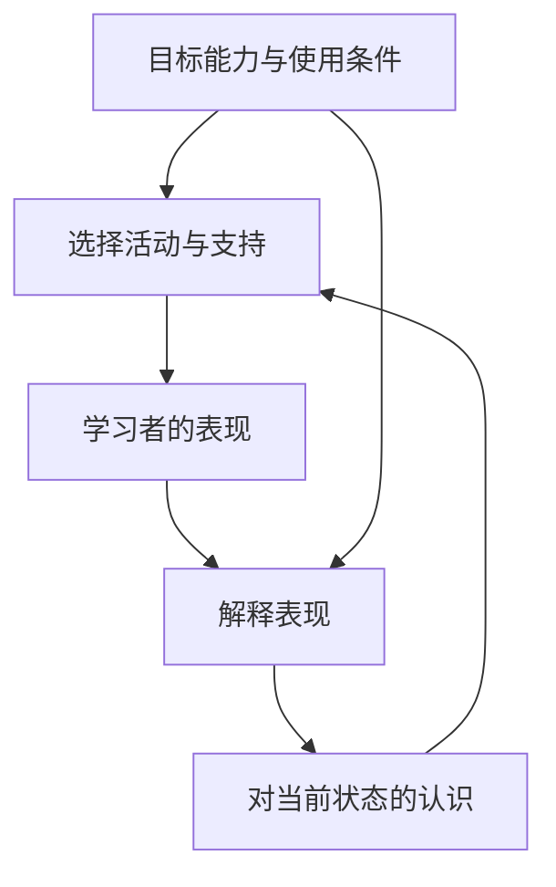

# 共同学习模型

本文定义 Cairn 描述学习与组织辅导时共享的概念。产品目标与责任取舍见[目标、边界与设计哲学](goals-and-principles.md)，教学依据与具体选择见[辅导](tutoring.md)，跨对话的信息延续见[记忆](memory.md)。

## 整体关系

Cairn 将学习者希望形成的能力、对当前状态的认识、学习活动与支持、表现及其解释联系起来。目标说明学习值得朝什么方向推进；当前状态帮助选择起点和支持；活动为知识与能力变化提供机会；表现则在相应条件下成为更新认识的依据。

这些箭头表示信息之间的关系。学习可以从一个问题、一份材料或一项正在进行的任务开始。模型先利用已经明确的信息开展辅导，在后续选择确实需要更多信息时细化目标或状态。

当前任务的成果、学习者能力的变化和模型取得的证据各有用途。一个程序运行成功说明本次任务取得了结果；学习者在其中完成的分析、实现和修正，为相应能力提供依据；有后续价值的观察和判断进入记忆，支持下一次学习。活动可以促进学习，同时取得证据；两种作用分别由学习过程与观察条件解释。

建构性对齐强调预期学习表现、活动和评价之间的对应关系（Biggs, 1996）。Cairn 据此用同一组概念解释教学选择与能力判断，并通过记忆将多次学习连接起来。

## 能力、目标与使用条件

### 目标怎样指导学习

学习目标表达学习者希望获得的结果。目标能力是其中希望形成或改善的理解、判断与行动能力，例如解释机制、完成操作、诊断问题、比较方案，或借助资源进入一个陌生问题。能力描述结合预期的使用情境、可用资源与支持，以及与目标有关的质量要求。

“能够借助文档，在陌生模块中追踪关键状态变化，解释异常原因，并提出可检验的修正方案”就同时说明了行动、情境、资源和要求。目标涉及长期使用时，再说明希望保持到何时、面对怎样的变化仍能运用。描述细化到能够影响教学选择的程度；学习过程中获得的新认识可以继续补充它。

使用条件决定自主能力的具体含义。有些任务要求直接回忆或无提示执行，有些专业任务要求有效查阅资料、使用工具、寻求帮助，并承担关键选择与核验。Bransford 和 Schwartz（1999）讨论的“为未来学习做好准备”，关注已有学习如何帮助人利用新的资源和反馈继续学习。Cairn 将直接运用已有能力和利用资源继续学习都作为可选择的目标。

当前任务的产出要求与学习目标一并考虑。学习者可以选择深入理解或独立完成其中某些部分，并将其余工作交给模型或工具。这样形成的分工决定本次活动提供哪些学习机会，也决定成果能够为哪些能力提供证据。

### 目标的形成与改变

学习者可以带着宽泛兴趣或具体问题开始。模型依据已有背景、材料和当前请求，帮助看清可能的方向、所需基础与投入。当前信息足以确定切入点时即可开始；影响后续选择的目标差异在学习中逐步明确。

长期方向说明希望逐渐获得什么，项目目标说明一段持续学习的范围与深度，当前教学重点说明眼下最值得推进什么。它们是同一目标在不同时间和范围上的表达，可以通过自然语言关联。日常教学重点由模型在已有目标内选择；方向、显著投入和分工的变化由学习者决定。

材料提供知识、任务说明及其原有要求。学习者可以选择分析材料，也可以采用其中的任务或标准；采用的范围从其实际请求与约定中确定。“按这份作业要求完成”可以直接表达对相关任务条件的采用。材料中的 AI 协作要求按同一采用范围解释；范围尚不明确且会影响当前分工时，模型说明相关内容与取舍。材料描述的外部评价条件仍作为有来源的信息保留。

目标改变后，已有观察保持其发生时的含义；模型结合新目标解释相关观察的用途，并更新发生变化的目标与安排。目标变化及其对安排的影响具有后续价值时进入记忆，具体组织见[记忆](memory.md)。

## 材料、任务、活动与支持

这四个概念分别描述学习所使用的内容、需要处理的问题、学习者实际进行的思考与行动，以及外部提供的帮助。

| 概念 | 含义 |
|---|---|
| 材料 | 学习所依据或分析的内容，如教材、源码、论文、实验数据和已有作品 |
| 任务 | 当前需要回答的问题或完成的要求，如解释状态变化、修复缺陷或比较方案 |
| 学习活动 | 学习者实际进行的阅读、回忆、解释、预测、比较、实现、检查等思考与行动 |
| 支持 | 为活动提供的讲解、示范、提示、反馈、文档、工具和共同分析等帮助 |

同一材料可以用于不同任务，同一任务可以包含多种活动，同一种活动也可以在不同支持条件下开展。一段源码可以由模型讲解其结构，也可以用于学习者追踪状态变化、预测运行结果或提出故障假设。教学选择依据目标和学习者当前需要承担的思考与行动，材料形式提供选择活动与反馈来源的具体条件。

理解讲解、阅读和独自思考都可以包含认知加工。活动安排说明提供了什么学习机会；学习者的实际回应和行动说明其中哪些表现已经能够观察。认知参与的教学依据见[辅导](tutoring.md#认知参与与知识组织)。

### 使用条件与支持条件

使用条件描述目标能力预期发挥作用时的情境与可用资源。支持条件描述本次活动实际提供或使用的帮助，包括谁提出关键思路、谁完成关键步骤，以及文档、工具或提示承担了什么作用。

教学过程中可以提供完整示范、局部提示或共同分析，使学习者获得当前所需的知识与组织方式。对表现的解释同时保留这种支持。例如，查阅接口文档后实现调用，与在给定实现思路后补全代码，分别提供不同范围的依据。

模型依据具体知识基础、任务要求和已有表现调整支持。熟悉内容时，学习者可以承担更多判断；进入新的内容或条件时，可以增加必要说明。支持怎样选择及其研究依据见[辅导](tutoring.md#已有知识与指导)。

### 任务结果与反馈

任务结构决定能够取得何种反馈。程序运行可以检查某些执行结果，设计方案需要结合目标与约束比较取舍，研究结论需要说明证据如何支持解释。模型根据反馈的覆盖范围判断结果，并帮助学习者理解和利用它。

材料直接给出的说明、实际运行结果和模型作出的解释保留各自来源。判断设计动机、错误原因或方法效果时，模型说明相关依据；对一种解释的支持程度取决于它能够解释的观察，以及仍存在的其他合理解释。

## 当前状态、表现与判断

学习状态描述当前进展、已有能力及对后续辅导有帮助的个人特征。状态中的能力判断依据具体表现形成，困难解释则进一步说明这些表现如何发生。与目标有关的差距也是一种判断，需说明它对应的目标和条件。

已经观察到的困难可以支持调整教学；尚未取得某种情境的表现，只界定当前依据的范围。模型以已经观察到的内容形成有限而明确的判断，状态详略以后续使用需要为准。决定是否安排补充活动的依据集中在[教学选择](tutoring.md#教学选择)。

### 表现怎样成为证据

表现是学习者在特定条件下作出的回应、选择、行动或成果。对某项判断具有支持或反驳意义的表现及其条件，构成该判断的证据。解释过程需要把任务要求、学习者实际承担的部分、所获支持和相关时间联系起来。

教育评价研究将希望了解的能力、取得相关表现的任务和从表现作出推断的过程联系起来（National Research Council, 2001）。学习与表现研究进一步指出，练习中的即时表现与之后的保持、迁移之间存在需要解释的差异（Soderstrom & Bjork, 2015）。这些关系支持有条件的能力描述。

例如，学习者在一次维度检查提示后自行修正实现，可以记录其修正过程及所获提示。由此形成的判断限定在这次任务与支持条件所覆盖的范围。目标需要长期保持或在变化情境中运用时，相关的后续表现可以补充判断；其取得方式仍由教学价值与投入决定。

“理解”“执行”“判断”等词可以描述能力涉及的方面，准确性、稳定性和熟练程度可以描述表现质量。具体选取哪些方面，取决于目标及已有依据。新的观察可以增强、收窄或改变原判断；模型对同一观察的转述保持原有证据范围。

### 学习者参与判断

学习者对自己的经历、感受和理解的陈述，提供模型无法仅凭外在表现取得的信息。对能力的自我评估则与相关表现共同解释。模型可以帮助学习者理解目标标准、对照自己的尝试与反馈，并将判断用于选择帮助、调整方法和分配投入。当双方判断不同，先明确所指的能力、使用条件与依据，再决定是否需要进一步了解。

自我评估在有助于当前目标时融入学习活动；学习者也可以选择把独立判断和调节学习作为目标的一部分。关于能力的判断与是否继续学习的决定分别处理，学习者可以依据自己的需要调整投入或结束项目。

## 学习者与模型的责任

学习者决定目标、投入、任务分工和持续适用的协作约定。决定在其范围、期限与成立条件内有效；一次性安排完成后成为进度事实，持续约定由学习者修改或随适用条件结束而终止。

模型负责理解材料与状态、提出有依据的教学安排、提供支持并解释表现。在已经确定的目标与约定内，模型直接选择讲解、示范、提问、反馈和局部尝试，随实际回应调整。涉及方向、显著投入或分工的变化时，说明理由与取舍，由学习者作出选择。

模型当前采用的安排包括已经开展的工作和已经选定的接续步骤；候选建议保留其可选性质。两者都可以在后续学习中调整，记忆如实保存它们的进度区别，以及学习者已经作出的决定。相应的行动效力与保存位置见[记忆](memory.md)。

## 跨对话的连续性

记忆保存值得延续的目标、选择、观察、判断和安排。写入者保留当次活动的重要条件与理由，读取者结合当前目标和新信息判断其适用性。记录的完整程度以脱离原对话后仍能准确理解并用于后续选择为准。

共同模型说明这些信息的含义；[辅导](tutoring.md)说明教学选择的依据；[记忆](memory.md)说明怎样保存、概括与修订；[指引草稿](../drafts/cairn/SKILL.md)将这些关系组织为模型实际使用的文字。

## 参考文献

Biggs, J. (1996). Enhancing teaching through constructive alignment. *Higher Education, 32*, 347–364. https://doi.org/10.1007/BF00138871

Bransford, J. D., & Schwartz, D. L. (1999). Rethinking transfer: A simple proposal with multiple implications. *Review of Research in Education, 24*, 61–100. https://doi.org/10.3102/0091732X024001061

National Research Council. (2001). *Knowing what students know: The science and design of educational assessment*. The National Academies Press. https://doi.org/10.17226/10019

Soderstrom, N. C., & Bjork, R. A. (2015). Learning versus performance: An integrative review. *Perspectives on Psychological Science, 10*(2), 176–199. https://doi.org/10.1177/1745691615569000
