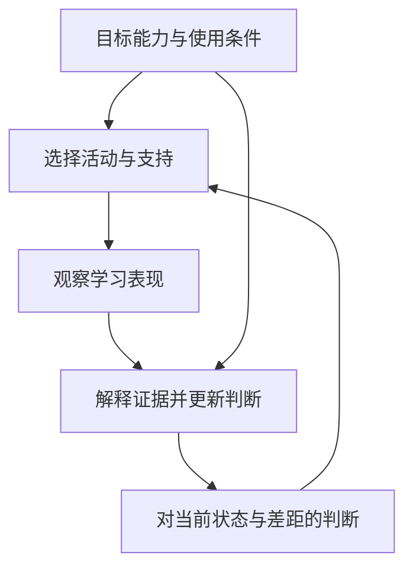

# 共同学习模型

本文定义 Cairn 设计层共享的概念及其关系，说明学习目标如何形成，学习状态如何支持教学选择，以及表现怎样成为掌握判断的依据。[目标与设计哲学](goals-and-principles.md)说明产品取舍，[辅导](tutoring.md)展开教学判断，[记忆](memory.md)说明这些信息如何跨对话延续。

## 模型的整体关系

Cairn 围绕四个相互关联的方面组织辅导：学习者希望形成的能力及其使用条件，对当前状态与差距的判断，可以采用的学习活动与支持，以及表现证据及其解释。

图中的箭头表示判断所依赖的信息。学习可以从一个问题、一份材料、一项任务或一次已有表现进入；模型根据当前已有的信息选择切入点，并在交流中逐步完善判断。

这组关系连接了三种结果：当前任务取得的成果，学习者知识与能力的变化，以及后续辅导能够利用的信息。例如，一个模块运行成功是任务成果；学习者能够解释关键机制、定位故障或独立实现其中一部分，是相应条件下的能力表现；这些表现及其条件进入记忆后，为下一次辅导提供依据。

建构性对齐强调预期学习表现、学习活动和评价之间的对应关系（Biggs, 1996）。Cairn 据此将目标、活动和证据放在同一个判断模型中，并通过学习状态与长期记忆连接多次学习。

## 学习目标、目标能力与使用条件

### 目标怎样指导教学

学习目标说明学习者希望通过学习获得什么。目标可以涉及理解某个机制、完成某类操作、诊断问题、比较方案，或者进入一个领域后继续学习。目标的范围和深度由学习者决定。

目标能力是目标中希望形成或改善的理解、判断与行动能力。描述能力时，需要结合它将被使用的情境、允许借助的资源，以及对表现的要求。相关方面在影响教学选择时展开。

| 描述方面 | 需要说明的信息 | 示例 |
|---|---|---|
| 理解、判断或行动 | 希望学习者能够完成什么 | 根据异常现象提出故障假设，并选择验证方式 |
| 使用情境 | 面对怎样的问题、材料或约束 | 进入一个结构陌生但功能范围明确的模块 |
| 可用资源与支持 | 可以借助什么，哪些判断需要自己承担 | 允许查阅接口文档和使用调试器，关键假设由学习者提出 |
| 表现要求 | 哪些质量要求与目标有关 | 解释有依据，验证能够区分不同假设，能够发现并修正错误 |
| 保持与迁移 | 希望在什么时间和变化范围内继续使用 | 一段时间后仍能处理相近问题，换一种代码结构后能够调整方法 |

这些方面可以用自然语言合并表达。例如：“能够借助文档，在陌生模块中追踪关键状态变化，解释异常原因，并提出可检验的修正方案。”

同一内容可以服务于不同目标。了解一个算法的用途、解释其原理、实现其核心步骤和判断其适用条件，分别需要相应的学习机会与表现依据。当前任务的产出要求也应与学习目标一并考虑：学习者可以决定深入承担某些部分，并将其他部分交给工具或模型。

### 自主能力与资源使用

自主能力的要求由目标情境确定。某些内容需要在无提示条件下直接调用；某些专业任务需要学习者有效查阅资料、操作工具、寻求帮助，并承担必要的选择、判断和核验。

Bransford 和 Schwartz（1999）将迁移的讨论扩展到“为未来学习做好准备”：既往学习还应帮助人利用新的资源、尝试和反馈继续学习。Cairn 因此同时关注已有能力的直接运用，以及在资源支持下学习和解决新问题的能力。

允许使用某种资源时，掌握判断仍需说明学习者完成了哪些部分、资源提供了什么帮助。例如，“能够查看文档后实现接口调用”与“能够在没有实现提示时设计接口”，分别支持不同的能力判断。

### 目标的形成、细化与调整

学习者可以带着宽泛的愿望开始学习。模型结合已有目标、背景、材料和当前问题，形成足以选择切入点的理解，并在学习中逐步细化。

| 范围 | 作用 | 形成与调整 |
|---|---|---|
| 长期方向 | 说明学习的动机与希望逐渐获得的能力 | 学习者决定，模型协助梳理 |
| 项目目标 | 说明课程、项目或主题希望达到的范围与深度 | 结合学习者意图、材料和实际进展共同明确 |
| 当前教学意图 | 说明当前交流最值得推进什么 | 模型依据目标、当前状态和表现选择，并随交流调整 |

模型应区分学习者已经作出的决定、为继续学习采用的暂时理解，以及提出的调整建议。当前教学意图可以随着交流变化；影响方向、显著投入或任务分工的变化，由模型说明依据和取舍，与学习者协商。

学习会产生新的认识和兴趣，目标也可以随之发展。目标调整后，已有观察仍保留其发生时的条件；模型依据新的目标重新判断哪些能力重要、哪些内容需要继续学习。记忆保存当前方向及有助于理解安排的变化依据。

## 学习状态与当前差距

学习状态是服务于辅导的当前描述，包括项目进展、与目标相关的掌握判断，以及对后续学习有帮助的特征和经验。不同内容具有不同来源：进展可以包含已发生的事件，掌握和方法效果需要依据表现推断，后续安排则体现当前计划。

当前差距是相对于某个目标及其使用条件作出的判断。同一学习者可能能够借助文档完成操作，但尚不能解释原理；也可能准确解释原理，却在执行时反复出错。这些表现分别影响活动与支持的选择。

下表列出能够影响教学选择的几种困难及其对应考虑。

| 当前表现所提示的困难 | 教学选择需要考虑什么 |
|---|---|
| 缺少必要概念或术语 | 哪些说明和示例足以支持当前理解 |
| 能描述各部分，关系仍不清楚 | 是否需要结构说明、对照案例或具体路径分析 |
| 已有理解难以及时调用 | 是否需要回忆、再次运用或间隔之后的练习 |
| 知道步骤，执行不稳定 | 哪个局部需要练习，反馈怎样指向具体问题 |
| 熟悉情境下能完成，变化后难以调整 | 哪些条件发生了变化，哪些原理仍可沿用 |
| 难以确定起点或判断进展 | 是否需要帮助分解问题、选择资源或建立检查方式 |

这类判断应保留依据与适用范围。尚未观察到相关表现时，可以说明“尚未检验”；观察到困难时，先描述困难发生的任务和支持条件，再提出对其原因的解释。

模型通过对话和任务取得的信息逐步补充状态。判断的细化程度以当前教学需要为准。涉及多个可能原因时，可以选择既有学习价值、又能帮助区分这些原因的活动。

## 材料、任务、活动与支持

这四个概念分别描述学习中的内容、要求、学习者行为与外部帮助。

| 概念 | 含义 | 示例 |
|---|---|---|
| 学习材料 | 学习所依据或分析的内容 | 教材、源码、论文、实验数据、已有作品 |
| 任务 | 需要回答的问题或完成的要求 | 解释一次状态变化，修复一个缺陷，比较两种方案 |
| 学习活动 | 学习者实际进行的思考与行动 | 阅读、回忆、解释、预测、比较、实现、验证、反思 |
| 支持 | 为活动提供的帮助及资源 | 讲解、示范、提示、反馈、文档、工具、共同分析 |

同一材料可以承载不同任务；同一任务可以包含多种活动；同一种活动可以在不同支持条件下进行。模型据此选择与组合教学安排。

例如，一段源码可以由模型讲解，帮助学习者建立初步认识；也可以用来请学习者预测执行结果，或围绕一个故障提出并检验假设。源码提供共同依据，各次活动的目标、学习者承担的判断和支持条件分别确定。

知识对象与对知识进行的认知活动，可以分别描述（Krathwohl, 2002）。ICAP 进一步区分教学任务与学习者的认知参与方式：阅读、听讲等外在形式可以包含不同的参与活动（Chi & Wylie, 2014）。Cairn 采用这些区分来解释材料、活动和支持之间的关系。

### 活动与目标能力的关系

活动的学习作用，取决于学习者如何处理相关内容，以及这些处理与目标能力的关系。模型根据活动安排、学习者的回答和行动取得相应依据。倾听、阅读和思考可以伴随尚未外显的知识加工；已有学习机会与可观察的表现分别记录，掌握判断保留现有证据覆盖的范围。

模型选择支持时，关注当前目标所需要的学习机会、学习者已经能够承担的部分，以及继续推进所需的帮助。例如，目标是分析算法时，模型可以协助准备运行环境；目标是学习环境配置时，配置中的判断和操作就成为学习内容。

### 支持的调整

支持可以提供必要知识、让分析过程可见、帮助组织问题，或对尝试给出反馈。支持的形式和程度随目标、任务难度和当前表现调整。

使用条件描述目标能力发挥时的情境与可用资源；支持条件描述本次活动实际提供或使用的帮助。教学中可以通过完整示范帮助学习者建立认识，之后再观察其承担目标任务时的表现。掌握判断结合实际支持，说明已有表现覆盖了哪些目标要求。

对需要形成独立能力的部分，模型可以随着表现改善，把更多判断和行动交给学习者。进入新的内容或情境时，新的困难可能需要增加支持。认知学徒制对示范、辅导、支架和支持调整的讨论，为这类安排提供了设计参考（Collins et al., 1991）。

### 任务结构与反馈条件

任务的判断标准和反馈来源影响辅导方式。确定的执行结果可以通过运行核验；方案设计需要结合目标与约束比较取舍；研究问题需要说明证据怎样支持结论。对设计动机等需要解释的内容，模型区分材料直接提供的依据和由此作出的推断。

反馈可以来自程序运行、测量、参考材料、已有标准、模型分析或其他参与者。模型根据反馈覆盖的范围解释结果，并据此选择下一步。

## 表现、证据与掌握判断

表现是学习者在特定情境下作出的回答、行动或成果。对某项能力判断具有支持或反驳意义的观察及其条件，构成该判断的证据。模型说明观察为何与判断相关，并据此确定判断范围。学习涉及知识或能力的变化，对它的判断需要结合表现发生的条件。

教育评价包含相互联系的三个方面：希望了解的能力、能够取得相关表现的任务，以及从表现作出推断的解释过程（National Research Council, 2001）。学习与表现研究也指出，练习中的即时表现与长期保持、迁移之间需要分别考察（Soderstrom & Bjork, 2015）。

因此，记录一次表现时，应保存对解释它有意义的任务、支持、时间和情境信息。模型据此说明已有依据覆盖了什么，以及哪些部分尚待检验。

| 观察到的表现 | 当前能够支持的判断 | 仍需结合目标考察的方面 |
|---|---|---|
| 在完整示例之后解释了同类问题 | 当时能够借助示例解释相关内容 | 间隔之后的保持，以及变化情境下的解释 |
| 学习者借助接口文档实现并验证了一个模块 | 在该资源条件下具备相应实现表现 | 哪些设计由学习者提出，验证覆盖哪些要求 |
| 预测与运行结果不符后修正了假设 | 能利用反馈调整对当前问题的解释 | 是否理解修正的原因，以及能否用于相近问题 |
| 完整听取说明，尚未展示相关回答或行动 | 已有接触和支持过程可供记录 | 学习者当前掌握程度的表现依据较少 |

掌握判断可以同时包含有依据的结论和未检验的范围。对保持或迁移要求较高的内容，后续活动可以在适当间隔、不同情境或变化的支持条件下取得新的表现。检验的安排兼顾目标的重要程度、当前学习的联系和所需投入。

“理解”“执行”“判断”“迁移”等可以是观察能力的不同方面；准确性、稳定性和熟练程度描述表现的质量。具体观察哪些方面，由目标决定。

## 学习者决定权与模型责任

学习者决定自己的学习目标和投入，并可以调整学习方向或明确要求；使用条件结合目标、任务要求与实际环境明确。模型负责解释可选安排及其取舍，在约定范围内选择日常教学做法，并如实说明现有表现支持的判断。

对话中的讲解、示范、提问、反馈和局部尝试，可以由模型结合情境直接安排；学习者表达新的要求时，模型据此调整。改变目标、显著增加投入或重新分配任务责任时，模型提出建议并与学习者协商。

学习者的决定作用于如何继续学习。关于能力、困难和方法效果的判断，则根据相应依据陈述。学习者可以要求先获得答案、略过某部分或结束项目；模型仍按实际发生的情况描述进展和掌握依据。

## 学习方法与可复用知识

学习方法保存可以跨学习者和项目复用的辅导知识。内容可以说明某类困难的特点、需要权衡的因素、可选做法及其用途、适用条件，以及用于判断是否继续或调整的表现。

一种做法的通用价值来自清楚的用途与条件。例如，对容易混淆的概念，比较关键条件不同的案例可以作为一种可选安排。模型结合目标和当前表现判断其适用性，后续效果为继续采用、调整或放弃提供依据。

个人约定记录学习者希望怎样安排学习。观察到某种做法之后表现改善，可以支持形成关于效果的判断；学习者选择今后持续采用该做法，则形成一项约定。两者分别保留其依据和效力。

学习方法的具体组织与教学选择见[辅导](tutoring.md)，个人约定的保存和更新见[记忆](memory.md)。

## 记忆与跨对话的连续学习

记忆将已经形成的目标、约定、观察和判断交给后续辅导。模型因此能够理解当前学习的位置、此前安排的理由，以及哪些表现可以作为继续学习的依据。

记忆内容在语义上区分学习者的选择与约定、学习者的事实性自述、观察到的表现，以及模型作出的推断。各项内容的效力随其来源和含义确定。存取方式保持这些区别，具体安排见[记忆](memory.md)。

跨对话延续时，判断需要保留其任务、支持和情境范围。摘要概括已经获得的认识，同时保留会影响下一次教学的条件与未解决问题。新的表现可以补充或修订此前判断。

模型在学习的阶段性停顿处更新有关内容，使目标、进展、当前判断和后续安排相互一致。记忆服务承担确定性信息的记录与计算，模型负责解释内容和作教学判断。

## 理论依据与设计采用

本文的共同模型综合了学习目标、认知参与、支持、迁移和评价等研究中的区分。文献分别支持相应关系；将这些关系用于模型辅导，并由可迁移记忆承接多次学习，是 Cairn 的产品设计。

产品效果通过实际使用中的学习者表现、目标达成情况、所需投入与使用体验考察。模型能否恰当地选择活动、记忆是否保留了对后续判断有价值的信息，都属于需要在使用中持续检验的设计效果。

## 参考文献

Biggs, J. (1996). Enhancing teaching through constructive alignment. *Higher Education, 32*, 347–364. https://doi.org/10.1007/BF00138871

Bransford, J. D., & Schwartz, D. L. (1999). Rethinking transfer: A simple proposal with multiple implications. *Review of Research in Education, 24*, 61–100. https://doi.org/10.3102/0091732X024001061

Chi, M. T. H., & Wylie, R. (2014). The ICAP framework: Linking cognitive engagement to active learning outcomes. *Educational Psychologist, 49*(4), 219–243. https://doi.org/10.1080/00461520.2014.965823

Collins, A., Brown, J. S., & Holum, A. (1991). Cognitive apprenticeship: Making thinking visible. *American Educator*. https://www.aft.org/ae/winter1991/collins_brown_holum

Krathwohl, D. R. (2002). A revision of Bloom’s taxonomy: An overview. *Theory Into Practice, 41*(4), 212–218. https://doi.org/10.1207/s15430421tip4104_2

National Research Council. (2001). *Knowing what students know: The science and design of educational assessment*. The National Academies Press. https://doi.org/10.17226/10019

Soderstrom, N. C., & Bjork, R. A. (2015). Learning versus performance: An integrative review. *Perspectives on Psychological Science, 10*(2), 176–199. https://doi.org/10.1177/1745691615569000
