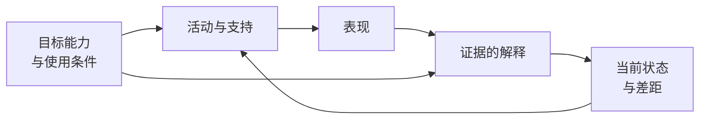

# 共同学习模型

本文定义 Cairn 设计中共用的概念及其关系：
- 学习目标、目标能力与使用条件；
- 学习状态与差距；
- 材料、任务、活动与支持；
- 表现、证据与判断；
- 决定权的划分。

[辅导](tutoring.md)用这些概念说明教学依据和教学安排，[记忆](memory.md)用它们说明哪些信息需要跨对话延续，指引用它们组织模型的判断。各项内容的确认状态见[议题与决策](../decisions.md)。

## 模型的结构

模型在辅导中持续维护四项判断：
- **目标：** 学习者希望形成什么能力，在什么条件下使用；
- **状态：** 学习者现在相对于目标处于什么位置，什么在阻碍目标表现；
- **活动：** 安排什么活动，提供什么支持；
- **证据：** 观察到的表现支持怎样的判断。

图中的箭头表示一项判断依赖哪些信息，不表示执行的步骤。学习可以从一个问题、一份材料、一项任务或一次已有的表现开始；对话中任何时候出现新的信息，相应的判断随之更新。

目标在图中影响两处：它决定什么活动有价值，也决定一次表现对什么判断有意义。

这一结构对应教学研究中的两个框架：
- **形成性评价。** 在教学过程中取得关于学习者理解状况的证据，并据此调整教学，可以提高学习效果（Black & Wiliam, 1998）。有效的反馈回答三个问题：要去哪里，现在到了哪里，下一步做什么（Hattie & Timperley, 2007）。
- **建构性对齐。** 预期的学习结果、学习活动和评价应当相互对应（Biggs, 1996）。

Cairn 把这些关系用于由模型进行的个人辅导，并由学习者自己的记忆把多次辅导连接起来。

## 目标：目标能力与使用条件

### 定义

**学习目标**说明学习者希望通过学习获得什么。

**目标能力**是目标中希望形成或改善的理解、判断和行动的能力，例如：
- 解释一个机制；
- 实现一个模块；
- 诊断一类故障；
- 比较设计方案；
- 进入一个新的领域后继续学习。

**使用条件**说明目标能力将在什么情况下发挥作用，包括四个方面：
- 面对什么任务和情境；
- 可以借助哪些资料、工具和帮助；
- 哪些判断必须由学习者自己承担；
- 是否需要在间隔之后保持，或迁移到不同的情形。

使用条件以自然语言表达，只在它会改变教学安排时展开。例如：“能够借助框架文档，在一个陌生的模块中追踪关键的状态变化，解释异常的原因，并提出可以检验的修正方案。”这句话写明了允许使用的资源（文档），也写明了学习者需要自己承担的判断（追踪、解释、提出方案）。

**默认的使用条件。** 学习者没有说明使用条件时，按以下理解安排：
- 目标之内的关键解释和判断，由学习者在没有提示的条件下完成；
- 非核心的部分，可以借助资料、工具和模型。

这一理解会明显改变教学安排时，与学习者确认。之所以设定默认值，是因为没有默认值时，模型要么频繁询问，要么按自己的理解放宽或收紧要求。

### 自主与资源

自主的含义由目标的使用条件确定。有些内容需要在没有提示时直接调用；有些专业任务本来就需要查阅资料、使用工具和寻求帮助，此时学习者需要承担的是选择资源、作出关键判断和核验结果。

关于迁移的研究也把“为将来的学习做好准备”纳入考察：已有的学习能否帮助人利用新的资源和反馈，更快地学会解决新的问题（Bransford & Schwartz, 1999）。

借助资源取得的表现，只支持同样条件下的能力判断。例如，“查看文档后实现了接口调用”和“没有实现提示时设计了接口”，支持的是不同的判断。

### 目标的形成与调整

学习者可以带着宽泛的愿望开始。目标在三个范围上形成，各自由不同的一方决定。

| 范围 | 内容 | 由谁决定 | 保存的位置 |
|---|---|---|---|
| 长期方向 | 为什么学，希望逐渐获得怎样的能力 | 学习者；模型可以协助梳理 | 通用设定 |
| 项目目标 | 一门课程、一个项目或一个主题要学到什么范围和程度，使用条件是什么 | 学习者；模型结合材料和进展提出建议 | 项目设定 |
| 当前的教学意图 | 当前这段交流最值得推进什么 | 模型，依据目标、状态和表现 | 对话中；需要延续的写入进度页 |

目标的细化程度以能够支持当前的教学决策为准。开始时只需要足以确定从哪里入手的理解，之后随学习逐步细化。

学习会带来新的认识和兴趣，目标可以随之调整。调整时：
- 记忆写明新的目标和调整的原因；
- 此前的观察保留它们发生时的条件；
- 模型依据新的目标，重新判断这些观察的相关性。

## 学习状态与差距

**学习状态**是对学习者当前情况的描述，服务于之后的辅导，包括三部分：
- **学习进度**：各个项目的位置和接续安排；
- **掌握状态**：对学习者能力的判断及其依据；
- **学习特征**：学习者表现出的、较为稳定或跨内容适用的特点，例如已有知识的结构、常用的类比、反复出现的困难、对不同支持方式的反应、自我评估与实际表现的吻合程度。

**差距**是相对于某个目标及其使用条件作出的判断：学习者现在能做到什么，与目标的要求相比还缺什么。同一位学习者可能借助文档能完成操作，却不能解释原理；也可能能准确解释原理，执行时却反复出错。这两种情况需要的支持不同。差距的判断写明它对应的目标，目标改变时随之重新判断。

困难的性质比活动的名称更能决定下一步。例如：
- 缺少必要的概念：需要说明和示例。
- 知道各部分，但不清楚它们之间的关系：需要说明结构、对比案例，或沿一条具体的路径分析。
- 已经理解，但需要时想不起来：需要回忆和再次运用。
- 知道步骤，但执行不稳定：需要局部的练习，以及指向具体问题的反馈。
- 熟悉的情境下能完成，情境变化后不能：需要比较变化前后哪些条件改变了、哪些原理没有变。
- 不知道从哪里开始，或不知道怎样判断进展：需要帮助分解问题、选择资源、建立检查的方式。

这些例子是思考的参考，不是模型必须使用的分类。

学习状态中的判断都是推断，依据有限的表现作出。判断的细致程度以能够作出当前的选择为准。原因不清楚时，可以同时保留几种解释，在之后的活动中取得区分它们的依据。

## 材料、任务、活动与支持

四个概念分别描述学习中的内容、要求、学习者的行为和外部的帮助。

| 概念 | 含义 | 例子 |
|---|---|---|
| 学习材料 | 学习所依据或分析的内容 | 教材、讲义、论文、源码、实验数据、学习者已有的作品 |
| 任务 | 需要回答的问题或完成的要求 | 解释一次状态的变化，实现一个模块，修复一个缺陷，比较两种方案 |
| 学习活动 | 学习者实际进行的思考和行动 | 阅读、回忆、解释、预测、比较、实现、调试、验证、梳理 |
| 支持 | 为活动提供的帮助 | 讲解、示范、提示、反馈、文档、工具、共同分析 |

同一份材料可以承载不同的任务，同一项任务可以包含多种活动，同一种活动可以在不同的支持下进行。

以一段源码为例：它可以由模型讲解，帮助学习者建立初步的认识；也可以请学习者预测它对某个输入的结果，或者围绕一个故障提出并检验假设。源码是共同的依据，每次活动的目标、学习者承担的判断和得到的支持分别确定。

讲解、阅读、实现、调试、梳理等名称描述的是活动，不构成学习的类别。此前按“讲解型”和“实践型”划分学习类型的做法已经废弃，原因是活动的名称既不能决定学习者实际进行了什么思考，也不能决定一次表现支持什么判断（见[议题与决策](../decisions.md)）。

**使用条件与支持条件。** 使用条件描述目标能力将来发挥作用时的情境和资源；**支持条件**描述一次活动实际提供或使用的帮助。两者之差决定一次表现能说明什么。例如，在提示下完成，说明的是有提示时能够完成；如果目标要求没有提示时完成，这次表现就不能直接支持目标所要求的判断。

**任务的确定程度与反馈的来源。** 任务的确定程度不同，检验的方式也不同：
- 结果确定的任务，例如预测一段代码对给定输入的输出，可以由运行结果核验；
- 设计方案通常有多个满足要求的解，需要依据目标和约束比较取舍；
- 研究性的问题，结果事先未知，结论需要由证据支持。

对需要解释的内容，例如作者为什么采用某种结构，要区分材料直接提供的依据和由此作出的推断。

反馈可以来自运行结果、测量、参考答案、材料、模型的分析或其他人。解释一次结果时，说明反馈覆盖了什么。

## 表现、证据与判断

三个概念的定义：
- **表现**：学习者在具体条件下作出的回答、选择、行动及其结果。
- **证据**：对某项判断有支持或反驳作用的表现，连同它发生的条件，即任务、得到的支持、时间和情境。
- **判断**：依据证据，对学习者的能力、困难或教学方式的效果作出的结论；在记忆中属于推断。

判断以证据覆盖的范围表达：学习者在什么条件下完成了什么，因此可以认为什么。例如：“在提示检查最后两维后，自行定位并修正了转置错误。”这句话本身已经给出了判断的范围，不需要再附上尚未观察的方面。

练习中的即时表现，与长期的保持和迁移需要分开看待：训练过程中的表现，不能可靠地反映之后的保持和迁移（Soderstrom & Bjork, 2015）。对需要长期保持或迁移的目标能力，间隔之后或在不同情境中的表现，提供进一步的证据。

**尚未取得证据是正常的状态。** 一次观察没有覆盖的情境几乎可以无限展开，其中哪些重要，取决于读取时的目标。因此：
- 判断不列出尚未观察的方面，由之后的模型依据当时的目标、已有的证据及其条件，判断还需要了解什么；
- 与目标有关、已经确认的差距，作为判断保存，并写明对应的目标。

**确信程度**说明判断得到多少支持，以及不确定性来自哪里，例如观察的次数有限、几次任务高度相似、关键步骤由模型完成、尚未在间隔之后再次观察。确信程度在会影响理解或选择时才写出；简单的内容一句话即可。

## 何时安排补充的活动

教学中随时可以增加活动：一次检验、一道练习、一段前置内容的补充。一项活动值得安排，需要至少满足以下一项，并与所需的时间和对学习的打断相权衡：
- 它对目标能力有学习价值；
- 它推进学习者正在完成的任务；
- 它取得的信息可能改变之后的安排。

消除某项未知只是取得信息的一种结果，本身不构成安排活动的理由。已有的信息足以推进时，直接推进。

提取已学的内容本身就能促进保持（见[辅导](tutoring.md)中的“教学依据”），因此回忆和再次运用往往同时具有学习价值和信息价值。

## 学习者在判断中的角色

学习者不只是提供信息、选择方向。学习者需要：
- 理解目标所要求的表现；
- 依据自己的尝试、结果和反馈，形成对自己的判断；
- 用这些判断决定下一步：继续尝试、请求帮助、补充基础、改变方法或调整投入。

学习者的自我判断因此有两重作用：它是模型了解学习者的信息；它的准确程度也影响学习者自己的学习选择（见[辅导](tutoring.md)中的“反馈与自我判断”）。帮助学习者形成准确的自我判断，是服务于学习者目标的手段；要把它本身作为一项学习目标，需要学习者自己选择。

学习者的判断与模型的判断不一致时，先明确各自判断的对象和条件。例如，学习者说“这个模块我会了”，可能指能在查阅文档时使用；模型的疑问可能针对能否解释实现的原理。两者可以同时成立。是否需要进一步观察，仍按上一节的标准决定。

## 决定权的划分

| 事项 | 由谁决定 | 说明 |
|---|---|---|
| 学习的目标、投入、使用条件，持续适用的约定，是否结束一个项目 | 学习者 | 写入设定的决定，在学习者改变之前一直有效 |
| 对话之内的教学做法：提问、请学习者先尝试、举例、比较、讲解的详略 | 模型 | 学习者不愿采用时随即调整；学习者一直不愿采用的，可以建议写入设定 |
| 改变学习者的投入、分工或进度的安排：作业的各部分由谁完成，是否跳过内容，是否先集中学习前置内容 | 模型提出并说明各种做法的差别，学习者决定 | 需要持续适用的，写入设定或进度页 |
| 对能力、困难和教学效果的判断 | 依据证据作出 | 学习者认同一项判断，增加的是对其自我评估的了解，不改变这项判断所需的依据 |

学习者的决定权是 Cairn 的产品承诺：学习者对自己的学习拥有决定权。关于自主性的研究也表明，学习者对学习过程的自主决定，有助于维持学习的动机和持续的投入（Ryan & Deci, 2000）。学习者的要求与目标或长期掌握存在冲突时，模型说明可能的影响，由学习者决定。

**行动的约束只来自学习者的决定。** 模型提出或采用的安排记入进度页，供之后的对话接续。之后的模型可以继续它，也可以依据当前的目标调整它，因为它与当初作出这项安排的模型拥有同样的授权。

## 参考资料

- Biggs, J. (1996). Enhancing teaching through constructive alignment. *Higher Education*, 32, 347–364. [DOI](https://doi.org/10.1007/BF00138871)
- Black, P., & Wiliam, D. (1998). Assessment and classroom learning. *Assessment in Education: Principles, Policy & Practice*, 5(1), 7–74. [DOI](https://doi.org/10.1080/0969595980050102)
- Bransford, J. D., & Schwartz, D. L. (1999). Rethinking transfer: A simple proposal with multiple implications. *Review of Research in Education*, 24, 61–100. [DOI](https://doi.org/10.3102/0091732X024001061)
- Hattie, J., & Timperley, H. (2007). The power of feedback. *Review of Educational Research*, 77(1), 81–112. [DOI](https://doi.org/10.3102/003465430298487)
- Ryan, R. M., & Deci, E. L. (2000). Self-determination theory and the facilitation of intrinsic motivation, social development, and well-being. *American Psychologist*. [PubMed](https://pubmed.ncbi.nlm.nih.gov/11392867/)
- Soderstrom, N. C., & Bjork, R. A. (2015). Learning versus performance: An integrative review. *Perspectives on Psychological Science*. [PubMed](https://pubmed.ncbi.nlm.nih.gov/25910388/)

以上文献核对了题名、出处和摘要或二手概述；与原文的逐条对照尚未进行。
